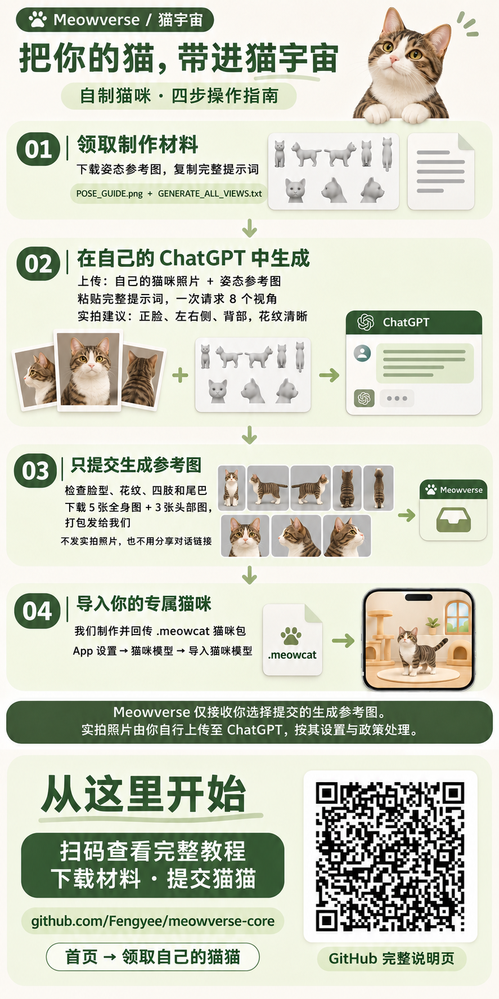
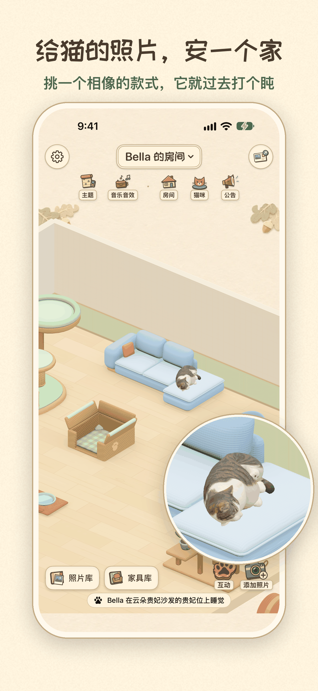
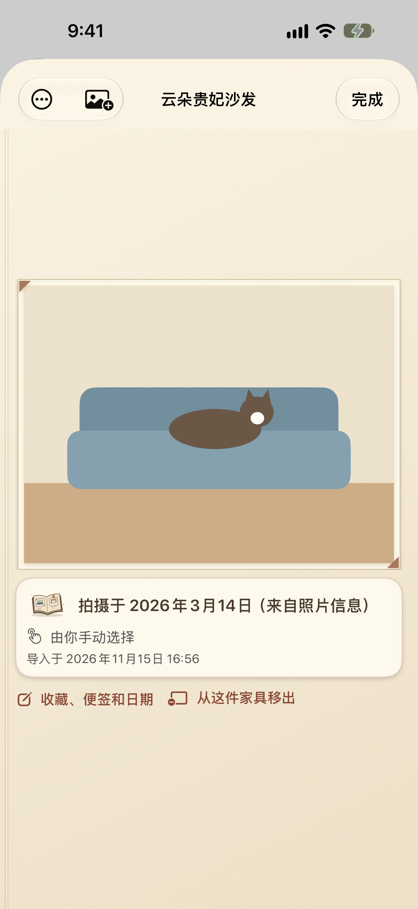
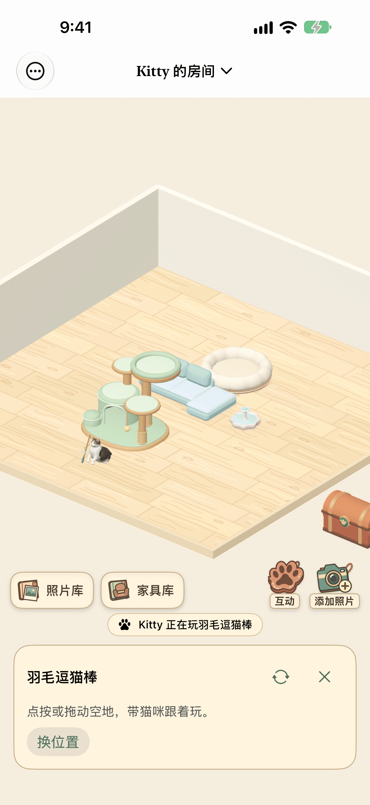
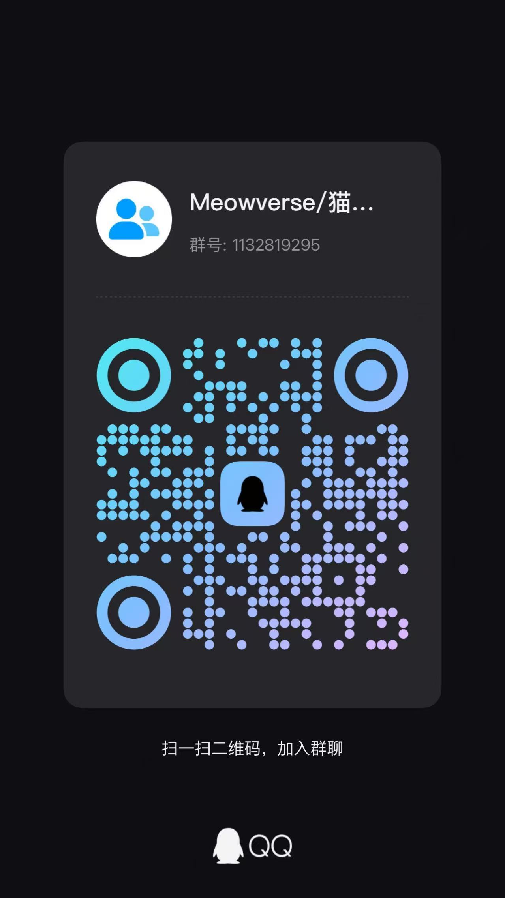

<div align="center">

[简体中文](README.md) | English

# Meowverse

### A little world for your cat's everyday moments

Turn a favorite sofa or a sunny windowsill into a little corner where you can revisit your photos.

<p>
  
  
  <a href="https://testflight.apple.com/join/WCuPQFsm"></a>
  <a href="https://github.com/Fengyee/meowverse-core"></a>
  <a href="https://github.com/Fengyee/meowverse-core/blob/main/LICENSE"></a>
</p>

### [Join the iOS TestFlight beta →](https://testflight.apple.com/join/WCuPQFsm)

**iPhone / iPad · Simplified Chinese / English · Free beta**

[Try the web demo](https://fengyee.github.io/meowverse/) · [QQ community](#community) · [Report a problem](https://github.com/Fengyee/meowverse-core/issues/new/choose)

[Get started](#try) · [Your own cat](#your-cat) · [Screenshots](#preview) · [Source and license](#source) · [Build and test](#build) · [Contributors](#contributors) · [Feedback](#feedback)

</div>

As of November 14, 2026, the current TestFlight build is **0.1.0 (3)**. This round is capped at **200 testers**; check the TestFlight page for availability. Testing and feedback are free. The web version remains a frozen feature demo, while development focuses on the native iOS app.

<a name="try"></a>

## A little room for your cat's daily life

- **Your cat photos keep piling up.** Save them in the photo library first, then organize them into a familiar sofa or window corner when you have time. One piece of furniture can hold several photos.
- **You want a quiet break after a busy day.** Arrange the room, play with the cat using a toy, or keep a pixel cat on your Lock Screen.
- **You want to keep your little world.** Make a room postcard or export a ZIP backup to help when moving to another device.

Start with a cat photo you have permission to use. Check the furniture suggestion, choose a model and a position, and confirm it. Later, tap that piece of furniture to open its linked photos. Apple's Vision framework suggests furniture from a preset catalog on your device, and you make the final choice. This is not photo-to-3D reconstruction.

> **Try the complete app in TestFlight.** This repository contains `MeowverseCore`, extracted from the November 14, 2026 main branch (`0084971`, schema 11), which builds and tests independently. The complete app's interface, 3D renderer and production artwork are not included. The code is **source-available** under a noncommercial license; see [Source and license](#source).

<a name="your-cat"></a>

## Bring your own cat

Prepare references in your own ChatGPT account, then request a manually made cat pack:

1. Attach photographs of your cat and the gray `POSE_GUIDE.png` to a message in your own ChatGPT conversation, **but do not send it yet**.
2. Paste the complete `GENERATE_ALL_VIEWS.txt` prompt into **that same message**, then **send it once**, requesting eight views: five full-body and three head views.
3. Check the poses and markings, fix missing or inconsistent views, and download the selected full-resolution generated images. Aim for eight separate square images.
4. Send only those selected generated images for manual review. If a finished `.meowcat` pack is provided, import it through Settings → Cat models → Import Cat Model in a compatible app build.

A contact sheet can be submitted for **preliminary review only**; separate full-resolution generated views may still be needed.

**[Read the English guide and get the reference materials →](docs/cat-creation/README.en.md)** · [Submit generated references in a public issue](https://github.com/Fengyee/meowverse-core/issues/new?template=03-cat-reference.yml)

<a href="docs/cat-creation/cat-creation-flow-bella.png"></a>

*The Bella poster explains the steps in Chinese; the linked guide provides the English instructions. Download the actual gray pose template rather than using the poster as a template.*

Your real photographs are uploaded to the third-party ChatGPT service you choose, under its policies and your account settings. **Do not send source photographs, chat transcripts or conversation links in the Meowverse request.** The GitHub issue and attachments are public; attach only selected generated reference images you are comfortable making public.

Participation is optional. Preparation is manual, with no guaranteed acceptance, completion or delivery date. The app imports finished `.meowcat` files; it does not automatically turn uploaded reference images into a cat. Submissions are for reference review and the requested cat pack; built-in, training or asset-release use needs separate confirmation. See the [guide](docs/cat-creation/README.en.md) for upload limits and use boundaries.

<a name="preview"></a>

## Recent screenshots

<table>
  <tr>
    <th align="center">Arrange everyday memories</th>
    <th align="center">Tap furniture to revisit a photo</th>
    <th align="center">Spend a moment with your cat</th>
  </tr>
  <tr>
    <td align="center"></td>
    <td align="center"></td>
    <td align="center"></td>
  </tr>
</table>

*Real interfaces from recent development builds running in the simulator; the photos are programmatically drawn examples. These screenshots were captured on November 12–13, 2026, before 0.1.0 (3), and are not screenshots of that build. The current TestFlight app is the reference for the available experience. [Image sources and attribution](docs/media/ATTRIBUTION.md).*

<details>
<summary>What you can try in the current TestFlight app</summary>

- **Organize memories.** Add one or several photos, then sort or skip them one at a time. Choose a cover for a piece of furniture and browse the links from either the photos or the furniture.
- **Decorate the room.** Pinch to zoom and pan around the 15×15 room. Choose seasonal wallpapers and optionally let the lighting follow the local time of day.
- **Tidy your furniture.** Search, filter, sort, lock and select several pieces in the furniture library. Put stored furniture in the chest beside the room.
- **Play with the cat.** Invite the cat onto furniture, pick a toy or offer a treat. On devices with Live Activities, start a Lock Screen pixel cat from Play; iPhones with Dynamic Island can also show it there.
- **Use it your way.** Use iPad in portrait or landscape. The interface follows your system's Simplified Chinese or English language setting, and local reminders are optional.

New Room and Add Cat currently show a lock and open an explanation of a future version. They are not enabled in this beta. In-app iCloud room syncing is not available either.

We would especially like feedback on whether your existing photos and furniture survive an update, whether an exported backup restores correctly, and how reminders behave over several days. The beta is still being improved; use the installed build as the reference.

</details>

<details>
<summary>The idea: one piece of furniture, an everyday memory</summary>

The room starts empty, and you decide what belongs in it. Furniture in a photo can provide inspiration; pieces created while organizing photos keep their confirmed photo links. You can also choose furniture directly from the catalog, with an explicit no-photos state until you attach a photo. Correct a suggestion, change the model or position, or leave a photo in the library to organize later.

Furniture appearances come from preset models. Recognition suggestions and cat animations help you organize and revisit memories; an animation is not evidence that a particular action happened in a photo. Capture dates distinguish image metadata, dates you enter and unknown dates. Import time does not stand in for capture time.

</details>

<a name="source"></a>

<details>
<summary>Source scope: the current core library and its noncommercial license</summary>

This package was extracted from **main on November 14, 2026, at commit 0084971**, with library schema **11**. It contains `MeowverseCore` code, tests, required catalog JSON and a synthetic backup fixture. The core covers data models, photo reading and reduction, furniture catalogs and grid rules, interaction routes and state, library persistence, photo and furniture queries, reminder planning and backup validation.

This is an independently buildable Swift library. It does not include the TestFlight app's SwiftUI interface, RealityKit renderer, app-level photo-library and notification integration, Lock Screen and Dynamic Island extensions, or production cat, furniture and icon assets. The screenshots show recent app development builds, rather than a screen produced by running this library.

The code and the identified required program data use the **[PolyForm Noncommercial License 1.0.0](LICENSE)**. You may use, modify and redistribute them for purposes permitted by that license; commercial use requires separate authorization. Redistribution must retain the terms and required notices as specified in the license.

This is **source-available** software. Because it restricts commercial use, it is not described as a standard open-source release. The full [LICENSE](LICENSE) governs; see [LICENSE-SCOPE.md](LICENSE-SCOPE.md) for the file and non-code material boundaries, and [SOURCE-RELEASE.md](SOURCE-RELEASE.md) for the extraction record.

</details>

<a name="build"></a>

<details>
<summary>Build the core library and run its tests</summary>

You need macOS 15 or later, Swift 6 and the complete Apple developer toolchain. The package declares iOS 18 compatibility. It uses Apple system frameworks, has no external Swift Package dependencies and requires no model API key.

Run this command from the repository root:

```sh
swift test --package-path ios/MeowverseCore
```

It builds the core library and runs the included tests. The images and ZIP files used in tests are synthetic, and the required fixtures are included. You do not need private photos or production model files.

Independent local verification: **344 tests across 44 suites passed**. This result covers the included core library, not the complete app's UI, system permissions or performance on a physical device.

There is no complete app target here, so this command does not produce an installable Meowverse app. Use TestFlight for the full product experience. Core tests do not replace UI, device or permission checks.

```text
ios/MeowverseCore/
  Package.swift                 Swift library and test definitions
  Sources/MeowverseCore/         Core code and required catalog data
  Tests/MeowverseCoreTests/      Unit tests and synthetic fixtures
docs/media/                     Finished screenshots for the project showcase
support/                        Project community and information images
```

</details>

<details>
<summary>Photos, privacy and backups</summary>

**The web demo.** Importing and organizing photos normally uses local browser storage. Its optional Claude analysis is a separate flow: you enter your own Anthropic API key, preview the image copies and explicitly consent before the browser sends those copies to Anthropic. Image content leaves your browser, and any charges belong to your API account. Removing metadata does not make a photo anonymous.

**The current TestFlight app.** You can use the system photo picker without granting full library access. The app also explains an optional feature for reading larger photos from your library, which works after you enable it and grant full access. It uses that access to look up photos already imported into the app. You can continue using the picker after declining or granting only limited access. Depending on your storage settings, the app keeps a reduced copy, or a small preview with larger images read from the system library when needed. If a library photo is removed or unavailable, retrieving the larger image depends on the system library; the saved preview remains available.

Vision generates furniture suggestions on your device; there is no cloud photo-analysis service. Reminders are optional local notifications. Reporting a problem opens the system mail composer, where you review the content and decide whether to send it. Apple's Photos service may download library images from iCloud according to your device settings. In-app iCloud room syncing is not available. Choose where to save or share device backups and exported ZIP files.

**This library's storage rules.** `PhotoIngest.makeDraft` tries by default to reduce larger photos to a longest side of 2048 pixels. It stores the reduced copy only if conversion succeeds and produces a smaller file; otherwise it retains the input bytes. Callers can use a 1024-pixel limit for small previews linked to library photos. `reducedFrom` records the source hash, dimensions and byte size before reduction. A photo record's hash verifies the bytes actually stored; this does not mean that every mode retains the original file from Photos.

Library identifiers can be saved with the record. PhotoKit access, permission handling and user-facing notices belong to the app layer and are not included in this library. Capture dates distinguish image metadata, dates entered by the user and unknown dates. Backup and restore validate the hashes of stored files and preserve the bytes described by the backup; replacement follows confirmation.

The library contains rules for cloud-backup state and retention. Their presence does not mean that the app has enabled cloud syncing, and they do not provide a cloud photo-analysis service. For the behavior of a particular app version, also check About & Privacy inside that version and the [current privacy policy](https://fengyee.github.io/meowverse/privacy.html).

</details>

<a name="contributors"></a>

## Contributors

Project maintainer: [**Fengyee**](https://github.com/Fengyee).

AI collaboration tools used during development: **Claude (Anthropic)** and **Codex (OpenAI)**.

The maintainer is responsible for product decisions and releases. This section acknowledges the development tools; GitHub's automatic Contributors list continues to reflect actual commit records. See [CONTRIBUTORS.md](CONTRIBUTORS.md) for more detail.

<a name="feedback"></a>

## Help make it better

Use the [bug report or experience suggestion forms](https://github.com/Fengyee/meowverse-core/issues/new/choose), TestFlight feedback, Settings › Report a Problem in the app, or email [bella.meowverse@gmail.com](mailto:bella.meowverse@gmail.com). A bug report only needs the platform and a description of what you did and what happened. Version details, screenshots and logs are optional. Issues are public: leave out private original photos, complete backups, payment information, device identifiers and real API keys.

<a name="community"></a>

### Optional QQ community · Meowverse/猫宇宙

Join us to discuss the app, report problems or talk about cats. **Group number: `1132819295`**. Search for this number in QQ or scan the group code below.

**Joining the community, testing the app and sharing feedback are free.**

<a href="support/qq-group.jpg"></a>

The official repository is **[Fengyee/meowverse-core](https://github.com/Fengyee/meowverse-core)**. Project screenshots and the community code are provided for this project's presentation and community; their rights are separate from the code license. See [LICENSE-SCOPE.md](LICENSE-SCOPE.md).
