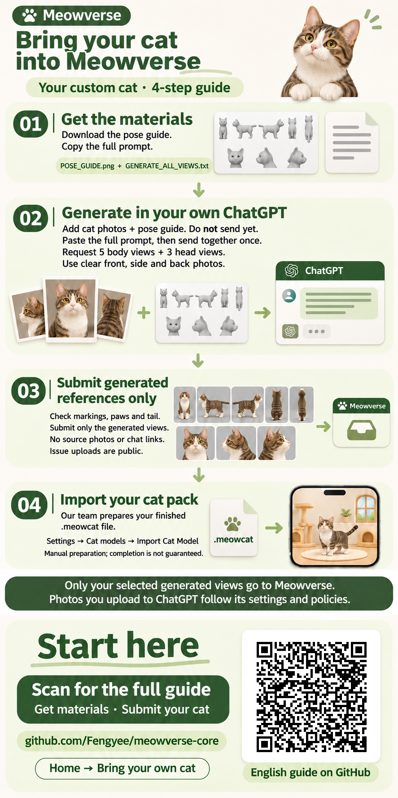
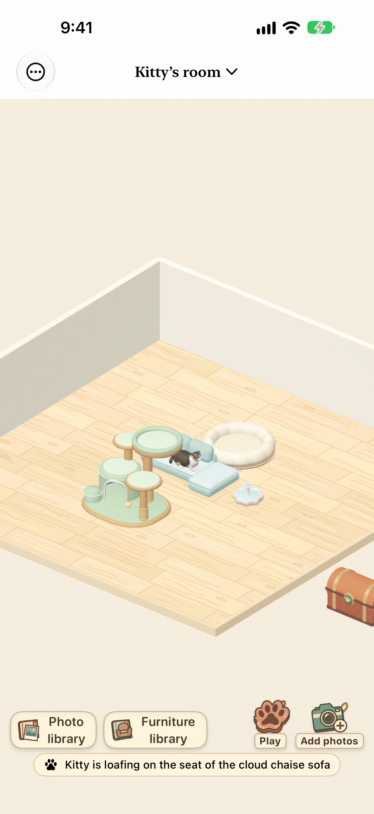
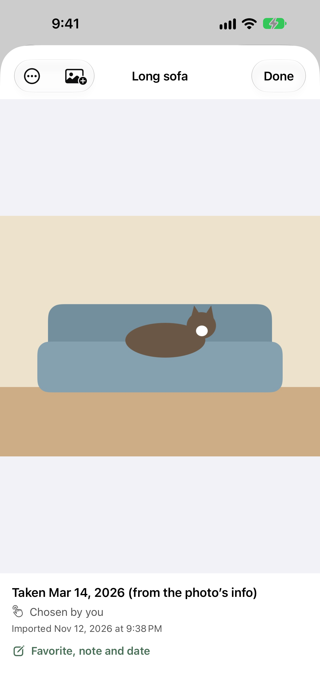
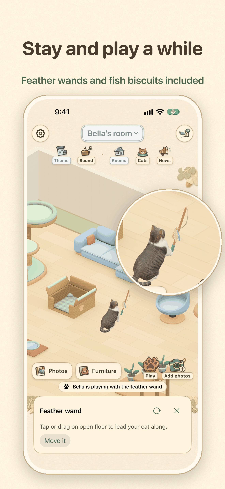

<div align="center">

[简体中文](README.md) | English

# Meowverse

### Let your photos grow into your cat’s little world

Build your cat a home, and turn the sofa it naps on or the sunny windowsill into a corner for revisiting your photos.

<p>
  
  
  
  <a href="https://github.com/Fengyee/meowverse-core"></a>
  <a href="https://github.com/Fengyee/meowverse-core/blob/main/LICENSE"></a>
</p>

### [Try it on TestFlight before the App Store release →](https://testflight.apple.com/join/WCuPQFsm)

**iPhone / iPad · Simplified Chinese / English · Free**

[Try the web demo](https://fengyee.github.io/meowverse/) · [QQ community](#community) · [A labor of love](#support) · [Report a problem](https://github.com/Fengyee/meowverse-core/issues/new/choose)

[Get started](#try) · [Your own cat](#your-cat) · [Screenshots](#preview) · [Source and license](#source) · [Build and test](#build) · [Contributors](#contributors) · [Feedback](#feedback)

</div>

As of November 24, 2026, Meowverse **1.0 (9)** is on its way to the App Store. It is entirely free, with no in-app purchases. Until then you can try it through TestFlight; check the TestFlight page for availability. The web version remains a frozen feature demo, while development focuses on the native iOS app.

<a name="try"></a>

## A little room for your cat's daily life

- **Your cat photos keep piling up.** Save them in the photo library first, then organize them into a familiar sofa or window corner when you have time. One piece of furniture can hold several photos.
- **You want a quiet break after a busy day.** Arrange the room, play with the cat using a toy, or keep a pixel cat on your Lock Screen.
- **You want to keep your little world.** Make a room postcard or export a ZIP backup to help when moving to another device.

Start with a cat photo you have permission to use. Check the furniture suggestion, choose a model and a position, and confirm it. Later, tap that piece of furniture to open its linked photos. Recognition runs on your device and suggests furniture from a preset catalog; you make the final choice. This is not photo-to-3D reconstruction.

> **This repository holds all the code of Meowverse 1.0; the art is not published.** It contains the app, the widgets and Live Activity, the `MeowverseCore` library, the tests and the Xcode project of the 1.0 version being prepared for the App Store, and it builds and tests without the art. The production cats, furniture, icons and other art are not included. The code is **source-available** under a noncommercial license; see [Source and license](#source).

<a name="your-cat"></a>

## Bring your own cat

Prepare references in your own ChatGPT account, then request a manually made cat pack:

1. Download the [user kit](docs/cat-creation/Meowverse-Cat-Reference-Kit.zip): the pose overview, eight single-view gray guides and ten prompts.
2. In one new ChatGPT conversation, send ten messages with **one gray guide per message**: message 1 attaches the overview and your cat photographs and settles the cat on one sheet; messages 2–9 make five full-body and three head views one at a time; message 10 packages them. Resend any view that is wrong, with its guide.
3. Compare each view with its guide, check the markings agree, and keep the packaged ZIP of full-resolution generated images.
4. Send only those selected generated images for manual review. If a finished `.meowcat` pack is provided, import it through Settings → Cat models → Import Cat Model in a compatible app build.

**[Read the English guide and get the reference materials →](docs/cat-creation/README.en.md)** · [Collection thread / attach in a comment](https://github.com/Fengyee/meowverse-core/issues/1) · [Create a separate cat request](https://github.com/Fengyee/meowverse-core/issues/new?template=03-cat-reference.yml)

<a href="docs/cat-creation/cat-creation-flow-bella-en.png"></a>

*The English Bella poster shows the earlier one-message version and includes a QR code to the English guide, which has the current steps. Upload the actual gray guides rather than the poster.*

Your real photographs are uploaded to the third-party ChatGPT service you choose, under its policies and your account settings. **Do not send source photographs, chat transcripts or conversation links in the Meowverse request.** The GitHub issue and attachments are public; attach only selected generated reference images you are comfortable making public.

Participation is optional. Preparation is manual, with no guaranteed acceptance, completion or delivery date. The app imports finished `.meowcat` files; it does not automatically turn uploaded reference images into a cat. Submissions are for reference review and the requested cat pack; built-in, training or asset-release use needs separate confirmation. See the [guide](docs/cat-creation/README.en.md) for upload limits and use boundaries.

<a name="preview"></a>

## Recent screenshots

<table>
  <tr>
    <th align="center">Arrange everyday memories</th>
    <th align="center">Tap furniture to revisit a photo</th>
    <th align="center">Spend a moment with your cat</th>
  </tr>
  <tr>
    <td align="center"></td>
    <td align="center"></td>
    <td align="center"></td>
  </tr>
</table>

*Real interfaces from a development build running in the simulator; the photos are programmatically drawn examples. These screenshots were captured from a development build on November 15, 2026, before 1.0, so some screens differ from the released app. [Image sources and attribution](docs/media/ATTRIBUTION.md).*

<details>
<summary>What is in 1.0</summary>

- **Organize memories.** Add one or several photos, then sort or skip them one at a time. Choose a cover for a piece of furniture and browse the links from either the photos or the furniture.
- **Decorate the room.** Pinch to zoom and pan around the 15×15 room. Choose seasonal wallpapers and optionally let the lighting follow the local time of day.
- **Tidy your furniture.** Search, filter, sort, lock and select several pieces in the furniture library. Put stored furniture in the chest beside the room.
- **Play with the cat.** Invite the cat onto furniture, pick a toy or offer a treat. On devices with Live Activities, start a Lock Screen pixel cat from Play; iPhones with Dynamic Island can also show it there.
- **See it elsewhere.** Home Screen and Lock Screen widgets and a Control Center control; on supported devices, AR puts the room on a real table.
- **Keep and sync it.** Export a ZIP backup, or turn on iCloud Drive backup and iCloud Sync to sync your room and photos between your own devices.
- **Use it your way.** Pick any of eight built-in cats and a quality tier. Use iPad in portrait or landscape. The interface follows your system's Simplified Chinese or English language setting, and local reminders are optional.

1.0 is entirely free, with no locks or in-app purchases. Several rooms, several cats and voice control are not finished and stay off in 1.0; a second room or cat already in a saved library still shows as usual.

We would especially like feedback on whether your existing photos and furniture survive an update, whether a backup restores correctly, how sync behaves between two devices, and how reminders behave over several days. The installed version is the reference for the experience.

</details>

<details>
<summary>The idea: one piece of furniture, an everyday memory</summary>

The room starts empty, and you decide what belongs in it. Furniture in a photo can provide inspiration; pieces created while organizing photos keep their confirmed photo links. You can also choose furniture directly from the catalog, with an explicit no-photos state until you attach a photo. Correct a suggestion, change the model or position, or leave a photo in the library to organize later.

Furniture appearances come from preset models. Recognition suggestions and cat animations help you organize and revisit memories; an animation is not evidence that a particular action happened in a photo. Capture dates distinguish image metadata, dates you enter and unknown dates. Import time does not stand in for capture time.

</details>

<a name="source"></a>

<details>
<summary>Source scope: all of the 1.0 code and its noncommercial license</summary>

This repository publishes all the code of Meowverse 1.0, the version being prepared for the App Store: the SwiftUI app and RealityKit room, photo import and organizing, furniture recognition, iCloud backup and sync, the onboarding tour, AR, the widgets, Live Activity and Control Center controls, the cat download extension, the `MeowverseCore` library, the unit and interface tests, and the Xcode project and build scripts. The source commit, file counts and differences from the development repository are in [SOURCE-RELEASE.en.md](SOURCE-RELEASE.en.md).

**The art is not published**: cat and furniture models, textures, room themes, illustrations, app icons, sounds, fonts and design source files are not in this repository. They are the work of the project and its collaborators, some used under third-party licenses, and they are not licensed with the code. The screenshots show the finished app, not what this repository alone produces.

The sponsor names on the About page and the cat cards are placeholders until the real details are confirmed; they are not the final list of credits.

The code and the identified required program data use the **[PolyForm Noncommercial License 1.0.0](LICENSE)**. You may use, modify and redistribute them for purposes permitted by that license; commercial use requires separate authorization. Redistribution must retain the terms and required notices as specified in the license.

This is **source-available** software. Because it restricts commercial use, it is not described as a standard open-source release. The full [LICENSE](LICENSE) governs; see [LICENSE-SCOPE.en.md](LICENSE-SCOPE.en.md) for the file and non-code material boundaries.

</details>

<a name="build"></a>

<details>
<summary>Build the app and run the tests</summary>

You need macOS, Xcode 27 and the iOS 26 SDK. There are no external Swift Package dependencies and no model API key to configure.

Run these commands from the repository root:

```sh
python3 ios/Tools/make-placeholder-art.py   # optional: grey placeholders for the asset catalogs
xcodebuild -project ios/Meowverse.xcodeproj -scheme Meowverse \
  -destination 'generic/platform=iOS Simulator' build
ios/test-core.sh                            # core library tests
```

The DINOv2 model weights used for furniture recognition (about 86 MB) are not in the repository. If you want them, convert `facebook/dinov2-with-registers-base` from Hugging Face (Apache 2.0) as described in [ios/Tools/EmbeddingLab/PROVENANCE.md](ios/Tools/EmbeddingLab/PROVENANCE.md) and put the result at `ios/Meowverse/Resources/Models/DinoV2ViTB14Reg.mlpackage`; that file gives the SHA-256 both model files should have. Without them the app makes furniture suggestions with Apple’s Vision framework.

The app builds and launches without the art, but icons and illustrations are grey squares and the room has no furniture or cat, so it does not look like the released app. The core tests use synthetic images and ZIP files; `ios/test-core.sh` skips the few tests that read art files and lists each one in the script. To install on a device you need your own developer team and app identifiers; see [SOURCE-RELEASE.en.md](SOURCE-RELEASE.en.md) for how, and for the test results. These checks do not stand for the released app's look, on-device performance or system permission acceptance.

```text
ios/Meowverse/                  App source (asset catalogs hold only Contents.json and colors)
ios/PocketCatShared/            Code shared by the app, widgets and Live Activity
ios/PocketCatWidget/            Widgets, Live Activity and Control Center extension
ios/MeowverseAssets/            Download extension for the cats' model tiers
ios/MeowverseCore/              Core library, unit tests and synthetic fixtures
ios/MeowverseUITests/           Interface tests
ios/Meowverse.xcodeproj/        Xcode project
ios/Tools/                      Recognition evaluation, DINOv2 conversion, placeholder art
docs/                           Technical documents, the cat reference guide, screenshots
support/                        Project community image
```

</details>

<details>
<summary>Photos, privacy and backups</summary>

**The web demo.** Importing and organizing photos normally uses local browser storage. Its optional Claude analysis is a separate flow: you enter your own Anthropic API key, preview the image copies and explicitly consent before the browser sends those copies to Anthropic. Image content leaves your browser, and any charges belong to your API account. Removing metadata does not make a photo anonymous.

**Meowverse 1.0.** The app reads only the photos you pick. The first time you add a photo, it asks once for access to your photos: with access it keeps only a small preview and reads the full-size photo from your library, and only for photos you have imported. Everything works without access; the app then keeps a reduced copy. If a library photo is removed or unavailable, retrieving the larger image depends on the system library; the saved preview remains available.

Furniture recognition runs on your device (a DINOv2 model, or Apple's Vision framework without it); there is no cloud photo-analysis service. Meowverse has no server of its own: when a quality tier needs the simplified cat models, the system downloads them from the App Store, and your photos and room are not sent anywhere. Reminders are optional local notifications. Reporting a problem opens the system mail composer, where you review the content and decide whether to send it. Apple's Photos service may download library images from iCloud according to your device settings.

**iCloud backup and sync are on in the 1.0 release, for free.** With Back Up to iCloud Drive on, backups go to your own iCloud Drive and the system uploads them. With iCloud Sync on, Meowverse syncs with your own devices through Apple’s iCloud, and the developer has no access to this data. You turn each one on in Settings. You decide where exported ZIP files are kept and who they are shared with.

**The core library's storage rules.** `PhotoIngest.makeDraft` tries by default to reduce larger photos to a longest side of 2048 pixels. It stores the reduced copy only if conversion succeeds and produces a smaller file; otherwise it retains the input bytes. Callers can use a 1024-pixel limit for small previews linked to library photos. `reducedFrom` records the source hash, dimensions and byte size before reduction. A photo record's hash verifies the bytes actually stored; this does not mean that every mode retains the original file from Photos.

Library identifiers can be saved with the record. PhotoKit access, permission handling and user-facing notices are in the app layer (`ios/Meowverse/Photos/`, `ios/Meowverse/Import/`). Capture dates distinguish image metadata, dates entered by the user and unknown dates. Backup and restore validate the hashes of stored files and preserve the bytes described by the backup; replacement follows confirmation.

The sync merge rules and the cloud backup state and retention rules are in `MeowverseCore`; the connections to CloudKit and iCloud Drive are in the app layer (`ios/Meowverse/Sync/`), designed in [docs/ICLOUD_SYNC.md](docs/ICLOUD_SYNC.md). For the behavior of a particular app version, About & Privacy inside that version and the [current privacy policy](https://fengyee.github.io/meowverse/privacy.html) are the reference.

</details>

<a name="contributors"></a>

## Contributors

Project maintainer: [**Fengyee**](https://github.com/Fengyee).

Creative: **Omucat**.

Beta testers: list coming soon. Thank you to everyone who tests the TestFlight builds and sends feedback.

AI collaboration tools used during development: **Claude (Anthropic)** and **Codex (OpenAI)**.

The maintainer is responsible for product decisions and releases. This section acknowledges the development tools; GitHub's automatic Contributors list continues to reflect actual commit records. See [CONTRIBUTORS.md](CONTRIBUTORS.md) for more detail.

<a name="feedback"></a>

## Help make it better

Use the [bug report or experience suggestion forms](https://github.com/Fengyee/meowverse-core/issues/new/choose), TestFlight feedback, Settings › Report a Problem in the app, or email [bella.meowverse@gmail.com](mailto:bella.meowverse@gmail.com). A bug report only needs the platform and a description of what you did and what happened. Version details, screenshots and logs are optional. Issues are public: leave out private original photos, complete backups, payment information, device identifiers and real API keys.

<a name="community"></a>

### Optional QQ community · Meowverse/喵空间

Join us to discuss the app, report problems or talk about cats. **Group number: `1132819295`**. Search for this number in QQ or scan the group code below.

**Joining the community, testing the app and sharing feedback are free.**

<a href="support/qq-group.jpg"></a>

<a name="support"></a>

### A labor of love

Meowverse is a labor of love. If you like it, please follow and star **[Fengyee/meowverse-core](https://github.com/Fengyee/meowverse-core)**.

Project screenshots and the community code are provided for this project's presentation and community; their rights are separate from the code license. See [LICENSE-SCOPE.en.md](LICENSE-SCOPE.en.md).
