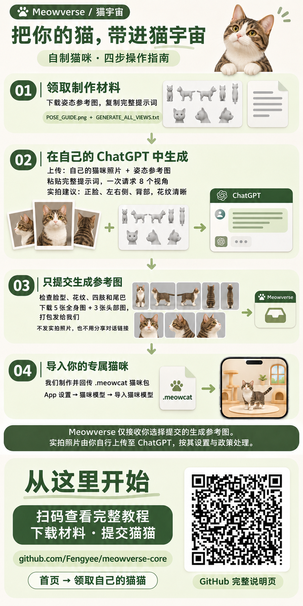
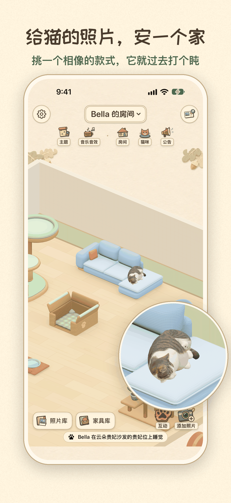
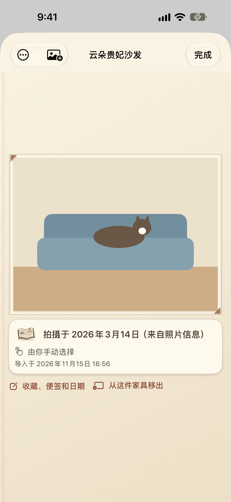
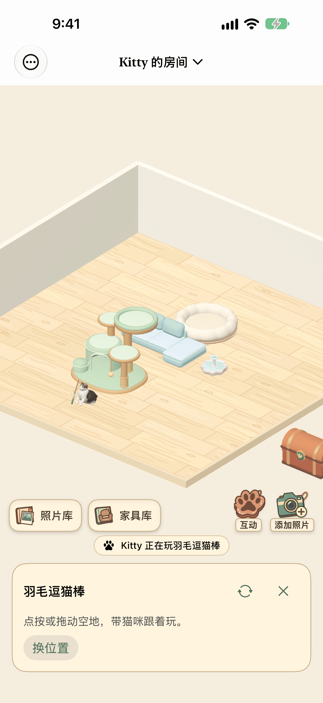
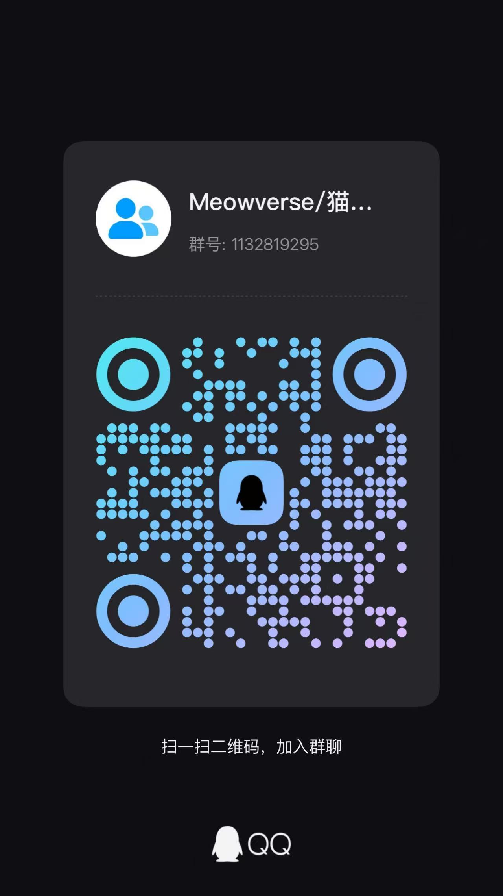

<div align="center">

简体中文 | [English](README.en.md)

# Meowverse

### 让你的相册长成猫咪的小世界

为猫咪搭一个家：常睡的沙发、晒太阳的窗台，都能变成可以回看照片的角落。

<p>
  
  
  <a href="https://testflight.apple.com/join/WCuPQFsm"></a>
  <a href="https://github.com/Fengyee/meowverse-core"></a>
  <a href="https://github.com/Fengyee/meowverse-core/blob/main/LICENSE"></a>
</p>

### [立即加入 iOS TestFlight 测试 →](https://testflight.apple.com/join/WCuPQFsm)

**iPhone / iPad · 简体中文 / English · 免费测试**

[先看网页版演示](https://fengyee.github.io/meowverse/) · [领取自己的猫猫](#your-cat) · [加入 QQ 群](#community) · [为爱发电](#support) · [反馈问题](https://github.com/Fengyee/meowverse-core/issues/new/choose)

[开始体验](#try) · [画面预览](#preview) · [源码与许可](#source) · [构建测试](#build) · [协作致谢](#contributors) · [一起反馈](#feedback)

</div>

2026-11-14：当前 TestFlight 为 **0.1.0（3）**，本轮测试人数上限 **200 人**；能否加入以 TestFlight 页面显示为准。参与测试和反馈都免费。网页版保留为功能演示，开发主线是原生 iOS App。

<a name="try"></a>

## 给猫咪留一间小房间

- **照片越拍越多，想慢慢整理。** 先存进照片库，有空再把照片放进熟悉的沙发或窗边；一件家具可以收下多张照片。
- **忙完之后，想有一点安静的陪伴。** 布置小房间、拿玩具陪猫玩，或在锁屏留一只像素猫。
- **想把小世界留住。** 制作房间明信片，或导出 ZIP 备份，为换设备做准备。

从一张你有权使用的猫咪照片开始，检查家具建议，选好款式和位置；以后点家具，就能打开与它关联的照片。识别由系统 Vision 在本机提出预设家具建议，最终由你确认；不提供照片的 3D 重建。

> **源码范围是喵空间 1.0 的全部代码，美术不公开。** 本仓库提供准备上架 App Store 的 1.0 的 App、小组件与实时活动、核心库 `MeowverseCore`、测试和 Xcode 工程，可以在没有美术的情况下编译和测试。猫咪、家具、图标等正式美术不随源码提供。源码采用非商业用途的 **source-available** 许可，具体范围见 [源码与许可](#source)。

<a name="your-cat"></a>

## 领取自己的猫猫 · 正在征集多视角参考图

想让你家猫也住进这个小世界？**用我们提供的灰模和提示词，在你自己的 ChatGPT 里一张一张生成参考图，再把选好的生成图交给我们。** 我们会人工检查，尝试制作能导入 App 的 `.meowcat` 猫咪包。这个征集流程独立于 App 内的本机家具识别，不是 App 内一键生成。

1. **领取材料。** [一次打包下载](docs/cat-creation/Meowverse-Cat-Reference-Kit.zip)：姿态总览图、八张单视角灰模和十条提示词。
2. **在自己的 ChatGPT 生成。** 一个新对话发十条消息，每条只附一张灰模：第 1 条附总览图和自家猫实拍，先出一张总览把猫定下来；第 2–9 条逐个视角出五张全身、三张头部；第 10 条打包。哪张不对就带着它的灰模重发那一条。
3. **只交生成图。** [创建猫猫投稿 Issue](https://github.com/Fengyee/meowverse-core/issues/new?template=03-cat-reference.yml)，拖入生成图或建议 20 MB 以内的 ZIP；不要发送实拍原照、聊天记录或对话链接。
4. **领取猫包并导入。** 制作完成后领取 `.meowcat`，在支持导入的 App 构建中打开「设置 → 猫咪模型 → 导入猫咪模型…」。

**[完整操作与下载 →](docs/cat-creation/README.md)** · **[征集帖／留言上传 →](https://github.com/Fengyee/meowverse-core/issues/1)** · **[为我的猫单独投稿 →](https://github.com/Fengyee/meowverse-core/issues/new?template=03-cat-reference.yml)**

<a href="docs/cat-creation/cat-creation-flow-bella.png"></a>

**Issue 和附件公开可见，生成图也不保证匿名；不愿公开的图片不要上传。** 猫咪实拍由你自行上传到 ChatGPT，按其账号设置与服务政策处理。直接图片单张上限 10 MB；ZIP 上限 25 MB，我们建议整理在 20 MB 以内。当前人工制作，不承诺每份投稿都能完成或确定时效；公开投稿不自动授权内置猫库或其他发行用途。[详细说明](docs/cat-creation/README.md)。

<a name="preview"></a>

## 近期画面

<table>
  <tr>
    <th align="center">把日常摆进房间</th>
    <th align="center">点家具，回到照片</th>
    <th align="center">陪猫玩一会儿</th>
  </tr>
  <tr>
    <td align="center"></td>
    <td align="center"></td>
    <td align="center"></td>
  </tr>
</table>

*开发版真实界面（模拟器）；照片为程序绘制示意。截图采自 2026-11-15 的开发主线，晚于 0.1.0（3），部分画面可能还没有进入 TestFlight；当前体验以 TestFlight 为准。[图片来源与署名](docs/media/ATTRIBUTION.md)。*

<details>
<summary>当前 TestFlight：可以体验什么</summary>

- **整理回忆。** 添加一张或多张照片，逐张整理或跳过；为家具选择封面，从照片和家具两边回看关联。
- **装扮房间。** 15×15 房间支持双指缩放与平移，提供季节墙纸；可选择让光线跟随当地时间。
- **收拾家具。** 家具库支持搜索、筛选、排序、锁定和多选；收起的家具放在房间旁的宝箱中。
- **陪猫互动。** 邀请猫咪到家具上，选玩具或喂零食；支持实时活动的设备可从“互动”启动锁屏像素猫，支持灵动岛的 iPhone 还能在灵动岛查看。
- **按自己的习惯使用。** iPad 支持横竖屏；界面跟随系统使用简体中文或英文；本地提醒由你选择开启。

“新建房间”和“添加猫咪”当前显示为锁定，只打开后续版本的说明。本轮尚未开放这些功能，也没有开放 iCloud 房间同步。

欢迎重点试一试升级后原来的照片和家具是否都在、导出备份后能否恢复，以及连续使用几天后的提醒表现。测试版仍在改进，当前体验以实际安装的构建为准。

</details>

<details>
<summary>体验设计：一件家具，留住一段日常</summary>

房间先留空，由你决定什么值得放进去。照片中的家具可以作为灵感；从照片整理出的摆设保留确认后的照片关联，也可先从目录挑选家具，尚未关联时明确显示没有照片。你可以修正建议、换款式和位置，也可以先把照片留在照片库，之后再整理。

家具的外观由预设模型提供；识别和猫咪动作是帮助整理与回看的表现，不作为照片里确实发生过某种动作的证据。拍摄日期区分图片记录、手动填写和未知，导入时间不代替拍摄日期。

</details>

<a name="source"></a>

<details>
<summary>源码范围：1.0 的全部代码与非商业许可</summary>

本仓库公开准备上架的喵空间 1.0 的全部代码：SwiftUI App 与 RealityKit 房间、照片导入与整理、家具识别、iCloud 备份与同步、新手导览、AR、小组件、实时活动和控制中心、猫咪分档下载扩展，以及 `MeowverseCore` 核心库、单元测试和界面测试、Xcode 工程与构建脚本。来源提交、文件统计和与开发仓库的差异见 [SOURCE-RELEASE.md](SOURCE-RELEASE.md)。

**美术不公开**：猫咪与家具的模型、贴图、房间主题、插画、App 图标、音效、字体和设计源文件都不在本仓库。它们是项目与合作者的作品，部分按第三方许可使用，不随代码授权。宣传截图展示的是成品 App，不是只靠本仓库能得到的画面。

关于页和猫咪卡片中的赞助人名字目前是占位写法，等真实信息确认后再更新，不是正式的鸣谢名单。

源码与列明的必要程序数据采用 **[PolyForm Noncommercial License 1.0.0](LICENSE)**：可以在许可证定义的许可用途内使用、修改和再分发；商业用途需要另行取得授权。再分发时须按原文保留许可条款和必要声明。

这是 **源码可见（source-available）** 的发行范围，因含非商业用途限制，不称为标准开源发行。条款以 [LICENSE](LICENSE) 全文为准；具体文件与非代码材料的范围见 [LICENSE-SCOPE.md](LICENSE-SCOPE.md)。

</details>

<a name="build"></a>

<details>
<summary>从源码构建与运行测试</summary>

需要 macOS、Xcode 27 和 iOS 26 SDK。没有外部 Swift Package 依赖，也不需要配置模型密钥。

在仓库根目录运行：

```sh
python3 ios/Tools/make-placeholder-art.py   # 可选：给资产目录补上灰色占位图
xcodebuild -project ios/Meowverse.xcodeproj -scheme Meowverse \
  -destination 'generic/platform=iOS Simulator' build
ios/test-core.sh                            # 核心库测试
```

没有美术也能编译和启动，但图标、插画是灰色方块，房间里没有家具和猫，和正式版的样子不同。核心库测试的素材是程序构造的图片与 ZIP；`ios/test-core.sh` 跳过少数需要读取美术文件的测试，并在脚本里逐条写明。装到真机需要自己的开发者团队和 App 标识，做法和测试结果见 [SOURCE-RELEASE.md](SOURCE-RELEASE.md)。这些检查不代表正式 App 的画面、真机性能或系统权限验收。

```text
ios/Meowverse/                  App 源码（资产目录只有 Contents.json 和颜色）
ios/PocketCatShared/            小组件、实时活动与 App 共用的代码
ios/PocketCatWidget/            小组件、实时活动、控制中心扩展
ios/MeowverseAssets/            猫咪分档模型的下载扩展
ios/MeowverseCore/              核心库、单元测试与合成测试资源
ios/MeowverseUITests/           界面测试
ios/Meowverse.xcodeproj/        Xcode 工程
ios/Tools/                      识别评测、DINOv2 转换、占位图脚本
docs/                           技术文档、猫咪参考图教程、展示截图
support/                        群二维码
```

</details>

<details>
<summary>照片、隐私与备份</summary>

**网页版 demo。** 普通导入与整理使用浏览器本地存储。可选的 Claude 分析是另一条流程：需要你输入自己的 Anthropic API key，预览分析副本并明确同意后，浏览器才把这些副本发送给 Anthropic，费用计入该 key 的账户。照片内容会离开浏览器，去掉元数据不等于匿名。

**当前 TestFlight。** 可使用系统照片选择器，也可在明确说明和你同意后授权图库读取。当前版本按存储设置保存缩小副本；开启并授权“从相册读取大图”后，会保存小预览，再按需从系统图库读取大图。相册里的照片被移除或无法读取时，大图能否取回取决于系统图库，界面会说明当前使用的预览。

家具建议在本机通过 Vision 生成，没有云端照片分析服务。提醒是可选的本地通知。反馈入口打开系统邮件编辑器，由你检查内容并决定发送。当前没有开放 iCloud 房间同步；设备备份和手动导出的 ZIP 应自行选择保存、分享位置。

**本库的保存规则。** `PhotoIngest.makeDraft` 默认尝试把较大照片缩到长边 2048 像素；仅在转换成功且文件更小时保存缩小副本，否则保留输入字节。调用方可使用 1024 像素上限供已链接图库照片的小预览使用。`reducedFrom` 记录缩小前来源的哈希、尺寸和大小，照片记录的哈希核对实际保存的字节，不能据此宣称所有模式都保留了相册原始文件。

图库标识可随记录保存；图库权限、PhotoKit 读取和页面提示由 App 层负责，不包含在本库中。拍摄日期区分图片记录、手动填写与未知。备份与恢复核对已存文件的哈希，恢复时保留备份中描述的字节，确认后才替换资料库。

库中包含云备份状态与轮换等规则，不表示当前 App 已开放云同步，也不提供云端照片分析服务。具体隐私行为请同时查看安装版本内的“关于与隐私”和 [当前隐私政策](https://fengyee.github.io/meowverse/privacy.html)。

</details>

<a name="contributors"></a>

## Contributors · 协作致谢

项目维护：[**Fengyee**](https://github.com/Fengyee)。

创意：**Omucat**。

测试鸣谢：名单整理中。感谢每一位参与 TestFlight 测试和反馈的朋友。

开发过程中使用的 AI 协作工具：**Claude（Anthropic）**、**Codex（OpenAI）**。

产品决策与发布由维护者负责。这里明确披露开发协作工具；GitHub 自动 Contributors 列表仍按实际提交记录生成。详细说明见 [CONTRIBUTORS.md](CONTRIBUTORS.md)。

<a name="feedback"></a>

## 一起把它做好

可以选择 [问题反馈或体验建议模板](https://github.com/Fengyee/meowverse-core/issues/new/choose) 提交内容，也可以使用 TestFlight 的反馈功能、App 内“设置 › 反馈问题”，或发邮件到 [bella.meowverse@gmail.com](mailto:bella.meowverse@gmail.com)。问题反馈只需选择平台、描述操作与实际表现；版本、截图和日志选填。Issue 公开可见，请避免附上私人原照片、完整备份、支付信息、设备标识或真实密钥。

<a name="community"></a>

### 加入 QQ 群 · Meowverse/喵空间

欢迎来群里交流使用体验、反馈问题和聊聊猫咪。**群号：`1132819295`**。可以在 QQ 搜索群号，也可以扫描下方二维码。

**入群、测试、反馈和交流都免费。**

<a href="support/qq-group.jpg"></a>

<a name="support"></a>

### 为爱发电

喵空间是一个为爱发电的项目。喜欢的话，请给 **[Fengyee/meowverse-core](https://github.com/Fengyee/meowverse-core)** 一个关注和 star。

宣传截图和群二维码仅供本项目展示，其权利范围独立于代码许可，详见 [LICENSE-SCOPE.md](LICENSE-SCOPE.md)。
