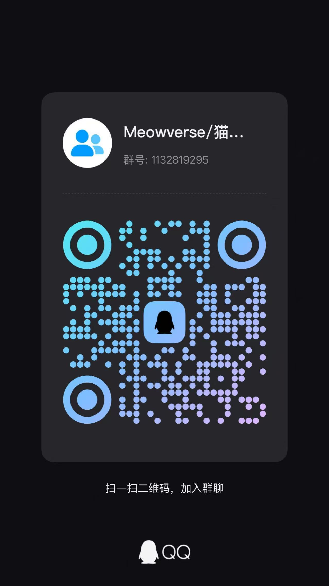

# Support Meowverse

[简体中文](SUPPORT.md) | English

Meowverse is developed by one person, in the hope that a little room can let a cat's ordinary moments be seen again.

**The developer membership is active and TestFlight is open.** The beta of 2026-11-14 is 0.1.0 (3): [join the beta for free](https://testflight.apple.com/join/WCuPQFsm). This round is capped at 200 testers; the TestFlight page shows whether you can still join.

**Current support goal: the first-year Apple Developer Program membership fee already paid, and ongoing development and maintenance.** Reaching a funding target is not a condition for testing, and no firm App Store release date is promised. The membership fee depends on the region of registration; this page gives no unverified spending figure.

Total support received so far: **not yet tallied**. Progress and development updates will follow; the tally will not publish payers' names, accounts or order details.

What you support here is the ongoing development of the Meowverse project. TestFlight offers the full app for testing; this repository provides only the MeowverseCore core library, without the app interface, 3D renderer or production art. See the [README](README.en.md) for the exact scope.

## WeChat and Alipay

**Official source repository: [Fengyee/meowverse-core](https://github.com/Fengyee/meowverse-core).** Check the ways to support in this repository's [SUPPORT.md](https://github.com/Fengyee/meowverse-core/blob/main/SUPPORT.md) ([English](https://github.com/Fengyee/meowverse-core/blob/main/SUPPORT.en.md)). Payment codes in reposted videos, screenshots or other forks do not prove where they came from on their own; check the browser address and the details shown by the payment platform before paying.

| WeChat | Alipay |
| --- | --- |
|  |  |

Only the name on each image is hidden. After scanning, the payment platform shows the recipient's details, and hiding the name on the image does not make the payment page anonymous. Check the recipient details shown by the platform before paying.

## What a tip is

Tips are entirely voluntary and support ongoing development. **Testing, feedback and the feedback group never require a tip.** A tip is not an app purchase, pre-order, investment or paid service order, and it is not tied to exclusive features, a firm release date or a review outcome.

You can report problems through TestFlight feedback, Settings › Report a Problem in the app, or [bella.meowverse@gmail.com](mailto:bella.meowverse@gmail.com). You are also welcome to join the **Meowverse/猫宇宙 QQ group** to talk about the app and report problems.

**Group number: `1132819295`. Joining is free; tips are optional.** Search for the group number in QQ, or scan the QR code below; the group entry is also [lower in the README](README.en.md#community).

When you share a problem, use synthetic or properly licensed images, and leave out private photos, payment information and device identifiers.

This page and the payment codes are only for describing how to support the project; the corresponding rights are reserved. The source package uses the PolyForm Noncommercial License 1.0.0 and is a source-available release; a tip does not buy a commercial license. See [LICENSE-SCOPE.en.md](LICENSE-SCOPE.en.md) for the exact scope.
