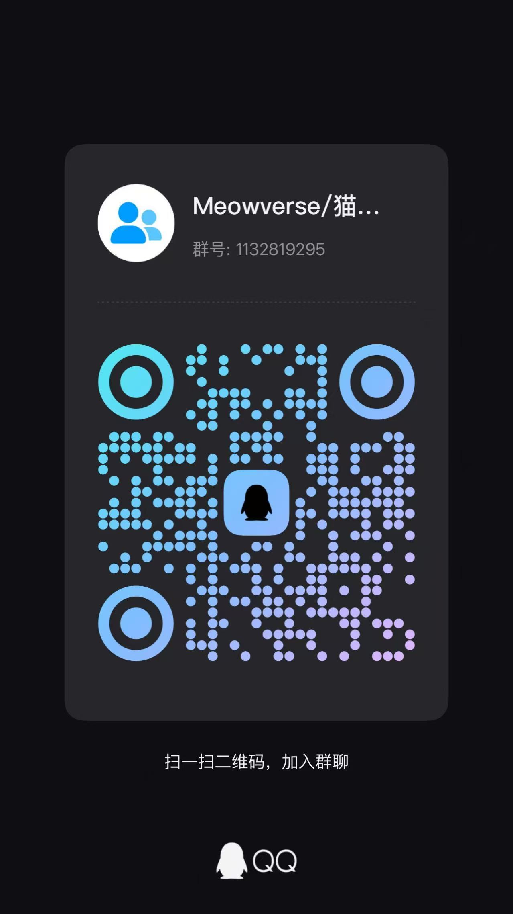

# 支持 Meowverse

简体中文 | [English](SUPPORT.en.md)

Meowverse 由个人持续开发，希望用一个小房间，让猫咪那些平常的瞬间有机会再被看见。

**开发者会员已经开通，TestFlight 已开放。** 2026-11-14 的测试版为 0.1.0（3）：[免费加入测试](https://testflight.apple.com/join/WCuPQFsm)。本轮测试人数上限 200 人，能否加入以 TestFlight 页面显示为准。

**当前支持目标：支持已投入的首年 Apple Developer Program 会员费用及后续开发维护。** 不以筹款达标作为开始测试的条件，也不承诺确定的正式上架日期。会员费用按实际注册地区计价，本页未给出未经核实的支出金额。

当前累计支持金额：**待统计**。后续会更新进度及开发情况；统计不公开付款者的姓名、账号或订单信息。

这里支持的是 Meowverse 项目的持续开发。TestFlight 提供完整 App 的测试体验；本仓库仅提供 MeowverseCore 核心库，不包含 App 界面、3D 渲染器或正式美术，具体范围见 [README](README.md)。

## 微信与支付宝

**官方源码仓库：[Fengyee/meowverse-core](https://github.com/Fengyee/meowverse-core)。** 请从这个仓库的 [SUPPORT.md](https://github.com/Fengyee/meowverse-core/blob/main/SUPPORT.md) 查看支持方式。转发视频、截图或其他 fork 中的收款图不能单独证明来源；付款前核对浏览器地址与支付平台显示的信息。

| 微信 | 支付宝 |
| --- | --- |
|  |  |

两张图片仅遮盖了图片上的姓名。扫码后的收款人信息由支付平台显示，图片打码不保证付款页面匿名。付款前请核对平台显示的收款信息。

## 支持的性质

打赏完全自愿，用于支持持续开发。**测试、反馈和后续反馈群都不要求打赏。** 打赏不构成 App 购买、预售、投资或付费服务订单，也不绑定专属功能、确定的上架时间或审核结果。

可以通过 TestFlight 反馈、App 内“设置 › 反馈问题”，或 [bella.meowverse@gmail.com](mailto:bella.meowverse@gmail.com) 提交问题。也欢迎加入 **Meowverse/猫宇宙 QQ 群**，交流使用体验和反馈问题。

**群号：`1132819295`。免费入群，打赏自愿。** 在 QQ 搜索群号，或扫描下方二维码；[README 下方](README.md#community) 也可直接查看群入口和打赏方式。

分享问题时，请使用合成或已获授权的图片，并去掉私人照片、支付信息及设备标识。

本页与收款图仅用于项目支持说明，保留相应权利。源码包采用 PolyForm Noncommercial License 1.0.0，属于源码可见（source-available）发行；打赏不购买商业授权。具体范围见 [LICENSE-SCOPE.md](LICENSE-SCOPE.md)。
