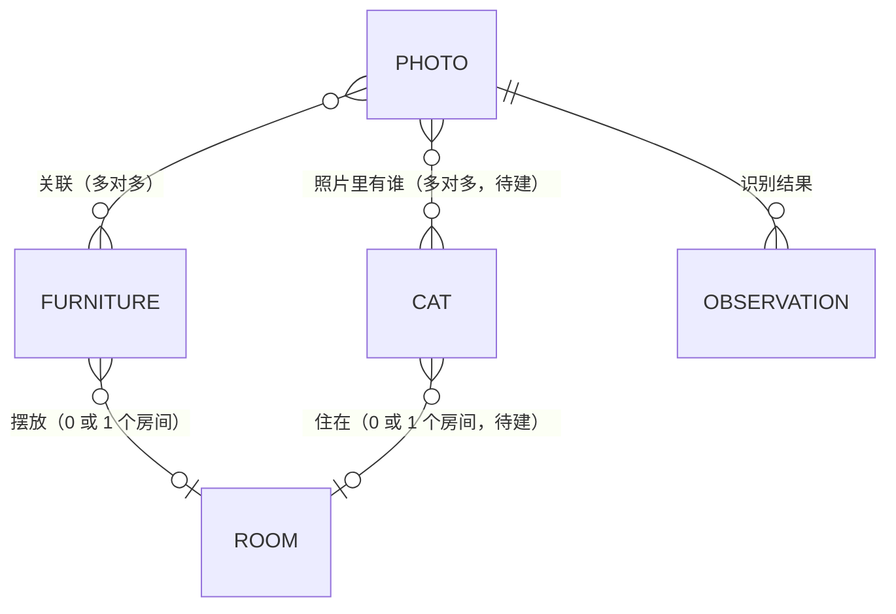

# 照片库与家具库：对象、关系和界面（iOS）

2026-11-13，owner 确认了第 9 节的决定。当前 iOS 实现包括第 8 节的访问器、照片关联管理和家具库。以下按集成后的存档版本 11 描述现状。网页版的模型见 [DOMAIN_MODEL.md](DOMAIN_MODEL.md)。

## 1. 结论

1. App 里有两个各自独立的库：**照片库**和**家具库**。照片不属于家具，家具也不属于照片。两者之间只有一种关系，叫**关联**，是多对多的。
2. 关联只记在一个地方：家具的 `sources` 列表。照片这一侧不存副本，反向查找靠程序建的索引。这一点现在已经如此，以后保持。
3. 家具“是什么”和家具“摆在哪”是两回事。当前用家具上的 `roomId` 区分房间。目标模型把摆放拆成家具上的一个可空字段。
4. 猫咪和照片的关系是另一条独立的关系，不经过家具。猫咪各自有稳定的 ID，照片上的猫咪标记仍待实现。
5. 现有数据不用推倒重来。多对多在数据层已经成立，缺的主要是界面：批量操作、从家具一侧选库里的照片、标签、筛选和家具库的管理信息。

## 2. 对象和关系



| 对象 | 是什么 | 归属 | 现状 |
| --- | --- | --- | --- |
| 照片 | 用户导入的一张照片及其记录 | 照片库，全局 | `PhotoRecord`，已有 |
| 家具 | 用户拥有的一件家具：款式、尺寸、配色、名字 | 家具库，全局 | `PhotoFurniture`，和摆放混在一起 |
| 关联 | “这张照片里有这件家具” | 记在家具上 | `PhotoCarrierSource`，已有 |
| 房间 | 一个网格空间和它的布局 | 全局 | 没有实体，只有一个隐含的房间 |
| 摆放 | 一件家具在某个房间的位置 | 记在家具上 | 混在 `PhotoFurniture` 的 `x z turn wall` 里；是否在房间由它在 `items` 还是 `storage` 数组决定 |
| 猫咪 | 一只猫：名字、外观 | 全局 | 只有 `catName` 一个字符串，外观由猫咪包另行选择 |
| 识别结果 | 一次对一张照片的分析 | 跟随照片 | `PhotoObservation`，已有 |
| 标签 | 用户写的短词 | 分别记在照片和家具上 | 家具有 `tags` 字段但没有界面；照片没有 |

### 关系规则

以下规则是之后所有功能的前提。标“现状”的已由代码保证，标“目标”的待实现。

**照片与家具（关联）**

- 一张照片可以关联 0 到多件家具；一件家具可以关联 0 到多张照片。（现状）
- 同一对照片和家具最多一条关联。（现状）
- 导入一张照片时最多建立 1 条关联，也可以不建。更多关联在导入之后添加。（现状）
- 关联只记在家具的 `sources` 里，顺序就是这件家具相册的显示顺序。照片记录上不存家具列表。（现状）
- 删除照片：所有指向它的关联一起删除，家具全部保留。（现状）
- 删除家具：它的关联一起删除，照片全部保留。（现状）
- 收纳家具：关联不变。（现状）
- 关联的来源（用户手动、识别结果）和“猫与家具的关系”记在关联上，用户确认的内容不被识别结果覆盖。（现状）
- 每条关联记录建立时间，用来算“上次添照片”。（现状，字段 `addedAt`；此前建立的关联和网页备份里的关联没有这个时间，显示为未知）

**家具与房间（摆放）**

- 一件家具同一时刻最多在一个房间里。不在任何房间就是在收纳箱里。（现状是单房间版本）
- 收纳箱是全局的，不属于某个房间。（目标）
- 每个房间最多 20 件家具；家具库总数不设上限。（现状是单房间 20 件）
- 照片不直接属于房间。“这个房间的照片”是算出来的：房间里各件家具的关联照片的并集。（目标）

**猫咪**

- 照片里有哪只猫，只由用户确认，可以是 0、1 或多只，也可以没标。没标就是未知，不由识别结果代填。（目标）
- 猫咪与家具没有直接关系。“这只猫在这件家具上的照片”是两条关系的交集。（目标）
- 一只猫同一时刻在一个房间里；一个房间可以有多只猫。（目标）

**标签与属性**

- 标签只来自用户输入。识别结果可以作为建议，用户点了才成为标签。（目标）
- “已收藏”“没放进家具”“日期未知”“在收纳箱”这类由数据算出来的状态叫**属性**，不是标签，不存盘。筛选可以同时用属性和标签。（现状已有三个属性筛选）
- 照片标签和家具标签是两套词表，机制相同。（目标）

## 3. 存档结构

### 现状（版本 11）

```
AppState
  catName: String             // 与第一只猫的名字一致
  rooms: [Room]?              // 缺省为 room-1
  cats: [Cat]?                // 缺省为 cat-1，名字取 catName
  photos: [PhotoRecord]
  observations: [PhotoObservation]
  items: [PhotoFurniture]      // 房间里的
  storage: [PhotoFurniture]    // 收纳箱里的
PhotoFurniture
  instanceId, modelId, width, depth, finish, displayName, tags   // 这件家具是什么
  roomId, x, z, turn, wall                                      // 摆在哪
  sources: [PhotoCarrierSource]                                 // 关联
  locked, coverPhotoId, createdAt, updatedAt                    // 可选；旧家具可缺省
```

目前的实现与后续方向：

1. `items` 里的家具按 `roomId` 归属各房间；`storage` 里的家具在共享收纳箱。
2. 界面代码原先直接读 `state.items`、`state.storage` 和 `catName`。**已解决**：界面现在只通过第 4 节的访问器读。
3. 家具原先没有创建时间和更新时间，关联没有建立时间。**已解决**：新建的家具和关联都记录时间，旧数据为空。
4. 猫咪已是独立实体。尚未记录照片里出现了哪只猫。

### 目标

```
AppState
  photos: [Photo]
  observations: [PhotoObservation]
  furniture: [Furniture]        // 全部家具，不分在哪
  rooms: [Room]
  cats: [Cat]

Photo        = 现有 PhotoRecord + tags: [String] + catIds: [String]?（nil = 没标）
Furniture
  furnitureId（沿用 instanceId 的值）
  modelId, width, depth, finish, displayName, tags
  locked: Bool?                 // 只在锁定时写 true，解锁后去掉，文件和没锁过一样
  coverPhotoId: String?         // nil = 用第一张
  createdAt, updatedAt: Date?   // 旧数据为 nil
  sources: [PhotoLink]          // 关联，顺序即显示顺序
  placement: RoomPlacement?     // nil = 在收纳箱
  lastPlacement: RoomPlacement? // 收纳前的位置，放回时作为建议
PhotoLink    = 现有 PhotoCarrierSource + addedAt: Date?
RoomPlacement
  roomId, x, z, turn, wall
Room
  roomId, name, 外观设置
Cat
  catId, name, packId（猫咪包）, roomId?
```

三处取舍的理由：

- **关联留在家具上，不单独建表。** 家具相册需要一个用户可调的顺序，数组顺序正好就是；删家具时关联自然消失；备份格式和网页版一致。代价是“照片在哪些家具里”要扫描，由索引解决（见第 4 节）。
- **摆放记在家具上，不记在房间里。** 这样“一件家具最多在一个房间”由结构保证，不需要额外校验。
- **尺寸和配色属于家具，不属于摆放。** 家具从一个房间搬到另一个房间，样子不变。

### 什么时候改存档

- 版本 8 的房间为 10×10。照片可带精简副本来源和相册标识；家具可带锁定、封面及时间，关联可带建立时间。主线另有多房间版本 8，写入可选的 `rooms`、`cats` 和家具的 `roomId`。
- 房间测试版 v9 支持 15×15；单房间集成版 v10 同时保留 15×15 坐标及完整的照片、家具字段。
- v11 读取 v1–v11，包括两种 v8、v9 与 v10。打开旧资料库时先在内存中迁移，下次保存写 v11；恢复备份会在替换前将暂存库写为 v11。新备份也标记 v11，旧版读取器会拒绝打开。
- 多房间沿用 `items` 和 `storage`。缺省的房间或猫咪列表表示一个默认房间和一只叫 `catName` 的猫。未指定房间的已摆家具属于第一个房间，收纳箱由所有房间共享。
- 合并成单个 `furniture` 数组和独立 `placement` 仍是后续方向。旧构建重写时会丢失的字段需要新存档版本。

## 4. 代码上的抽象

分三层，界面只碰后两层。

| 层 | 内容 | 位置 |
| --- | --- | --- |
| 记录 | 上面的存档类型，只有数据和编解码 | `MeowverseCore/Models.swift` |
| 命令 | 改数据的唯一入口。每条命令校验、改内存、落盘，一次完成 | `LibraryStore` |
| 查询 | 只读的派生结果：索引、筛选、排序、统计 | `PhotoLibrary`、`LibraryStats`，新增 `LibraryIndex`、`FurnitureLibrary` |

### 查询层

**`LibraryIndex`**（已实现，`MeowverseCore/LibraryIndex.swift`）：从一份 `AppState` 建出，状态变了就重建。App 里由 `AppModel.libraryIndex` 持有。

- `furniture(ofPhoto:)`、`photos(ofFurniture:)`
- `linkCount(ofPhoto:)`、`photoCount(ofFurniture:)`、`linkedPhotoIds`
- `photos(inRoom:of:)`
- `lastPhotoAdded(toFurniture:) -> Date?`
- `photos(ofCat:)` 等多猫咪时再加

照片库的格子和“没放进家具”筛选都走这个索引，列表不再每格扫一遍全部家具。

**房间和猫咪的访问器**（已实现，不改存档）：

- `state.allRooms`、`state.room(id:)`、`AppState.primaryRoomId`
- `state.allFurniture`、`state.placedFurniture`（所有房间里摆着的）、`state.furniture(inRoom:)`、`state.storedFurniture`、`state.roomId(ofFurniture:)`
- `state.allCats`、`state.cat(id:)`、`state.primaryCat`、`state.cats(inRoom:)`、`AppState.primaryCatId`
- App 里“当前房间”是界面状态，不进存档：`model.currentRoomId`、`model.roomFurniture`（当前房间的家具）。摆放校验、场景、猫咪日程都用当前房间的家具；家具库和选择器用全部房间的。

界面只读这些访问器，不直接读 `items`、`storage`、`catName`。新写的界面代码也要遵守。以后改存档结构时，只需要改访问器的实现。网格规则和猫咪日程的函数已经只接收一个家具数组，不依赖整个状态，不用改。

**筛选和排序**：`PhotoQuery`（属性 + 标签 + 家具 + 猫咪 + 日期范围 + 搜索词）和 `FurnitureQuery`（位置 + 分类 + 标签 + 有无照片 + 搜索词），加各自的排序枚举。它们是纯函数，在 Core 里用单元测试覆盖。

### 命令层

现有命令：`linkPhoto`、`unlinkPhoto`、`addPhoto`、`editPhoto`、`deletePhoto`、`addFurniture`、`rename`、`updatePlacement`、`stowFurniture`、`restoreFurniture`、`removeFurniture`。

需要新增的命令，都要求一次落盘、要么全部成功要么全部不变。已实现：`linkPhotos`、`unlinkPhotos`、`movePhotos`、`deletePhotos`、批量收藏 `setFavorite`（第 2 步），`reorderPhotos`、`setCover`、`setLocked`、批量 `stowFurniture(instanceIds:)` 和 `removeFurniture(instanceIds:)`（第 3 步）。标签和合并待做：

| 命令 | 用途 |
| --- | --- |
| `link(photoIds, to: furnitureId)` | 批量放进一件家具 |
| `unlink(photoIds, from: furnitureId)` | 批量移出 |
| `move(photoIds, from:, to:)` | 从一件家具移到另一件 |
| `deletePhotos(photoIds)` | 批量删除 |
| `setTags(photoIds / furnitureIds, add:, remove:)` | 批量加减标签 |
| `renameTag(old, new)`、`deleteTag` | 整理词表 |
| `reorderPhotos(furnitureId, order)`、`setCover` | 相册顺序和封面。顺序必须正好是这件家具的照片各一次；封面必须是这件家具里的照片，选第一张等于不选 |
| `setLocked(furnitureIds, Bool)` | 锁定。锁定后 `updatePlacement`、`stowFurniture`、`removeFurniture` 返回 `locked` 错误，照片、改名不受影响 |
| `stow(furnitureIds)`、`removeFurniture(furnitureIds)` | 批量收纳、批量删除。其中有一件锁定或不存在，整批不动；界面先把锁定的排除并告诉用户 |
| `mergeFurniture(from:, into:)` | 合并重复的家具，关联取并集 |

## 5. 多房间和多猫咪

多房间和多猫咪都已实现（2026-11-14）。1.0 全部免费，没有完整版和购买（owner，2026-11-22）。这两项还没做完，所以由编译开关 `FeatureFlags.severalRoomsAndCats`（1.0 为 false）隐藏：没有「新建房间」「添加猫咪」，也没有锁和说明页；`model.addRoom`、`model.addCat` 在动作处拒绝所有调用方。DEBUG / DRILLS 构建可以用启动参数 `-MeowverseSeveralHomes` 打开（`model.offersSeveralHomes`）。

开关只拦“新建”：新建第二个及以后的房间、添加第二只及以后的猫。已经在存档里的房间和猫（比如从备份恢复来的）照常显示、切换、改名、删除。开关在 App 层，不在存储层：存档格式不变，存储层不知道这个开关。

已定的规则：

- 第一个房间和第一只猫始终存在，不能删除，编号固定（`room-1`、`cat-1`）。第一只猫的名字就是 `catName`。
- 最多 8 个房间、6 只猫；每个房间最多 20 件家具，各算各的。
- 删除房间：里面的家具连同照片收进收纳箱，什么都不删；房间里有锁定的家具时拒绝，先解锁或搬走。住在那个房间的猫改为“跟着你”。
- 猫的 `roomId` 为空表示“跟着你”：你看哪个房间它就在哪个房间。
- 家具“搬到另一个房间”：原位置在新房间空着就保持原位，否则放到第一个空位；放不下就拒绝。锁定的家具不能搬。
- 当前看的是哪个房间记在设备上（UserDefaults），不进存档和备份。
- 一个房间里有几只猫：住在这里的和“跟着你”的。排在最前面的那只是“领头”的，底部的状态文字、邀请、玩具和零食都跟它；其余的猫各自按同一套日程活动，不参与邀请和玩耍。每只猫自己出发时不会选别的猫正待着或正走向的家具（`CatRoutine.nextTrip(avoiding:)`）；用户发出的邀请不受这个限制。地板上的路线没有互相避让，两只猫偶尔会走到同一格。
- 所有猫都住在别的房间时，这个房间里没有猫：状态文字写“这个房间里现在没有猫咪”，“互动”不可用，明信片照常能生成。

多猫咪还没做的：每只猫自己的外观（现在都用猫咪管理里选的那一个猫咪包）、照片上标“有哪只猫”（`catIds`）和按猫筛选、每只猫各自的提醒（提醒只用第一只猫的名字）。

| 问题 | 多房间 | 多猫咪 |
| --- | --- | --- |
| 新实体 | `Room` | `Cat` |
| 新关系 | 家具的 `placement.roomId` | 照片的 `catIds`；猫的 `roomId` |
| 库是否拆分 | 不拆。照片库和家具库始终全局，房间只是一个筛选条件 | 不拆。猫咪是照片库的一个筛选条件 |
| 收纳箱 | 全局一个 | 无关 |
| 上限 | 每个房间 20 件 | 待定 |
| 界面入口 | 房间切换；家具库按房间分组；“搬到另一个房间” | 猫咪切换；照片详情里标“有谁”；按猫筛选 |
| 主要工程量 | 存档迁移、房间切换界面、场景按房间加载 | 一个房间多只猫同时活动（路线互相避让）、每只猫的提醒和外观 |
| 现在要守住的 | 家具编号全局唯一；界面不直接读 `items` / `storage` | 界面不直接读 `catName`；识别结果不替用户指认是哪只猫 |

已知的局限：关联上的“猫与家具的关系”（在上面、在里面……）现在不分是哪只猫。多猫咪时如果需要区分，要把它改成按猫记录。目前这个字段在 iOS 上基本都是“不确定”，不影响现在的决定。

## 6. 管理多对多关系的界面规则

**两侧对称。** 关联可以从照片一侧改，也可以从家具一侧改，两边看到的结果一致。

| | 照片一侧 | 家具一侧 |
| --- | --- | --- |
| 看 | 照片详情列出所在的每件家具 | 家具详情显示全部照片 |
| 加 | “放进家具” | “从相册添加”和“从照片库选” |
| 减 | “从这件家具移出” | 选中照片后“移出” |

**四个动词，全 App 统一。**

| 动词 | 含义 | 会不会删东西 |
| --- | --- | --- |
| 放进 | 建立关联。照片原来在别的家具里的，仍然在 | 不会 |
| 移出 | 去掉一条关联 | 不会，照片和家具都在 |
| 移到 | 从当前家具移出，放进另一件。只在家具相册里出现 | 不会 |
| 删除 | 删掉照片或家具本身 | 会，要确认 |

**两个共用的选择器。**

- **选家具**（已实现，`FurniturePickerView`）：列出房间里和收纳箱里的全部家具，最近改动过的排前面，可搜索。照片详情、照片库的批量操作、家具相册的“移到”“也放进”、按家具筛选都用它。按家具筛选时可以勾选多件。还没做：导入流程改用它、底部的“新建家具”、一次把照片放进多件。
- **选照片**（已实现，`LibraryPhotoPickerView`）：照片库的网格加多选，可按“全部 / 收藏 / 未放进家具”筛选，已经在这件家具里的照片不出现。用于家具详情的“从照片库选”。

**批量操作。**（已实现，标签除外）照片库和家具相册都有“选择”模式，底部出现操作栏。照片库里批量放进家具和批量收藏完成后给一条 8 秒的提示，可以撤销；只有删除要确认，并写明受影响的家具数量。家具相册里的移出、移到、也放进不弹确认框，目前也没有撤销：撤销“移出”需要原样恢复关联的来源和时间，现有命令只能建立手动关联，所以先不做。

**数量随处可见。**（已实现）照片在两件以上家具里时，格子左下角标出件数；没放进任何家具的照片沿用原来的托盘标记和“未放进家具”筛选。家具行上标出分类、照片张数和上次添照片的时间，列表标题写明“房间里 n / 20”。

**导入时。** 单张导入可以选一件家具、新建一件，或者只存进照片库。批量导入可以整批放进同一件家具，或者先全部存进照片库，之后在“未整理”里处理。

## 7. 从用户角度看缺什么

优先级：P0 = 没有它，多对多关系管不动；P1 = 用户会明显觉得缺；P2 = 有了更好。

### 照片库

已有：按拍摄月份分组；“全部 / 收藏 / 没放进家具”三个筛选；逐张整理没放进家具的照片；详情里放大缩小、收藏、便签、改拍摄日期并可恢复、查看所在家具并放进或移出、用它新建家具、文件信息、删除。

| 缺口 | 说明 | 优先级 |
| --- | --- | --- |
| 多选和批量操作 | 放进家具、移出、收藏、删除（加标签待做） | P0，已实现 |
| 按家具筛选 | 选一件或几件家具，只看它们的照片 | P0，已实现 |
| 格子上的关联标记 | 现在只能点进详情才知道在几件家具里 | P0，已实现 |
| 左右滑动翻看 | 详情里现在一次只看一张，要退回网格再点下一张 | P1 |
| 标签 | 加、删、改名、按标签筛选 | P1 |
| 组合筛选 | 属性、标签、家具、日期范围可以同时用，并显示当前条件和结果数 | P1 |
| 排序 | 按拍摄日期、按导入时间，正序倒序 | P1 |
| 搜索 | 搜便签、标签、家具名 | P1 |
| 分享和存回相册 | 系统分享面板 | P1 |
| 日期未知的批量填写 | 选中多张一次填日期 | P1 |
| 重复和相似照片 | 相似度计算已有，缺一个“可能重复”的查看入口 | P2 |
| 网格缩放 | 双指改变每行张数 | P2 |
| 相册已删除的提示 | 打开了相册读取时，标出相册里已经找不到的照片 | P2 |
| 标注有哪只猫 | 等多猫咪 | 以后 |

**关于“编辑”。** 建议不做裁剪、滤镜这类改像素的编辑。理由：App 存的是缩小的副本或小预览，改它没有意义；真正的照片在系统相册里，那里的编辑工具更好。App 里的“编辑”只指改记录：日期、便签、标签、收藏。打开了相册读取时，大图直接从相册读，用户在相册里的修改会显示出来；本地预览可以加一个“从相册更新”的动作。

**关于照片信息。** 详情里已经显示拍摄日期及其来源、导入时间、尺寸和大小、存的是副本还是原样。建议补上：是否能从相册读到大图、所在家具数、标签。地点信息建议不显示也不读取，和“不翻看其他照片、不上传”的隐私说法保持一致。

### 家具库

已有：全屏的家具库页面（第 3 步），可搜索、按位置筛选、按分类 / 有没有照片 / 是否锁定筛选、五种排序、列表和封面两种视图、多选后批量锁定、收纳、删除；每行有封面、名字、分类、照片张数、上次添照片、是否锁定，以及定位、锁定、收纳或放回、删除的菜单；可以添加家具；详情里改名、换款式和配色、添照片、选封面、调整照片顺序、锁定、在房间里定位、收纳、放回、删除。

| 缺口 | 说明 | 优先级 |
| --- | --- | --- |
| 从照片库选照片 | 现在只能从系统相册添，库里已有的照片要重新选一遍 | P0，已实现 |
| 相册里多选 | 移出、移到另一件、也放进另一件 | P0，已实现 |
| 每行的管理信息 | 位置（房间里 / 收纳箱）、分类、照片张数、上次添照片的时间、是否锁定 | P0，已实现 |
| 筛选 | 按位置、分类、有没有照片、是否锁定（按标签待做） | P1，已实现 |
| 排序 | 按添加顺序、名字、照片张数、上次添照片、创建时间，可反向。时间没记录的家具总排在最后 | P1，已实现 |
| 锁定 | 见下 | P1，已实现 |
| 在房间里定位 | 从列表或详情点一下，回到房间并圈出这件家具约 3 秒 | P1，已实现 |
| 房间容量 | 显示“房间里 12 / 20” | P1，已实现 |
| 封面和照片顺序 | 相册里选中一张“设为封面”；“调整照片顺序”里拖动排序 | P1，已实现 |
| 标签 | 字段已有，缺界面 | P1 |
| 搜索 | 按名字（按标签待做） | P1，已实现 |
| 批量锁定、收纳、删除 | 多选 | P1，已实现 |
| 合并 | 把重复建的两件合成一件 | P2 |
| 复制一件 | 同款再摆一件，不带照片 | P2 |
| 按房间筛选、搬到另一个房间 | 有多个房间时出现；每行写明在哪个房间 | 已实现 |

**锁定的定义（已实现）。** 锁定的家具在布置模式里不能移动、旋转、换款式，不能收纳，不能删除，要先解锁。添照片、移出照片、改名、加标签不受影响。目的是防止整理房间时误碰。在房间里长按锁定的家具不会拿起它，顶部提示“已锁定”。收纳箱里的家具也可以锁定（防删除），放回房间不受限制。规则在存储层也拦一道，不只靠界面。

**“上次更新”的定义（建议）。** 列表里显示的是“上次添照片”，取这件家具最新一条关联的建立时间。改名、换色、挪位置不算。旧数据没有这个时间，显示为空，不用导入时间冒充。

**家具库的形态（已实现）。** 和照片库同级的全屏页面，列表和封面网格两种视图。从房间进入的入口不变。筛选和排序在这一次打开 App 期间保留，重启后回到默认。

## 8. 建议的顺序

每一步都可以单独发布。

1. **铺路，不改界面。（已完成）** 加 `LibraryIndex` 和房间、猫咪访问器，界面改读访问器；加关联的 `addedAt`、家具的 `createdAt` `updatedAt`。
2. **多对多管得动（P0）。（已完成）** 批量命令；照片库多选；“选家具”“选照片”两个选择器；家具相册多选；格子和行上的标记。
3. **家具库升级。（已完成）** 全屏页面、每行管理信息、搜索、筛选排序、锁定、定位、容量、封面和顺序、批量锁定收纳删除。没做：家具标签的界面、合并、复制一件。
4. **照片库升级。** 左右翻看、标签、组合筛选、排序、搜索、分享。
5. **多房间、多猫咪（已完成，1.0 隐藏，见第 5 节）**。集成构建写 v11，兼容主线开发版的多房间 v8。

## 9. 已确认的决定

owner 于 2026-11-13 按建议确认：

1. 标签分照片和家具两套词表。
2. 锁定按第 7 节的定义。
3. “上次更新”按“上次添照片”显示。
4. 不做改像素的照片编辑，不显示地点。
5. 家具库升级为全屏页面。
6. 多房间时收纳箱全局一个。
7. 按第 8 节的顺序实现。
