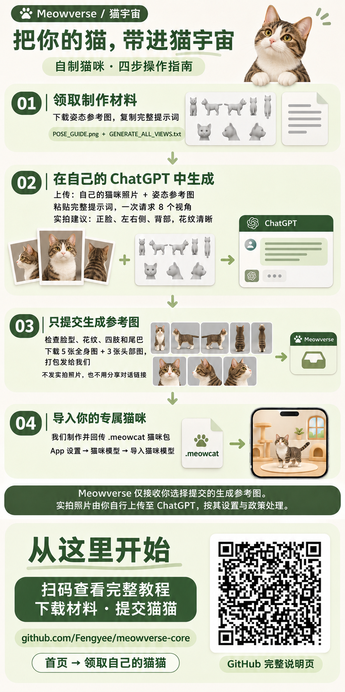

# Bring your own cat to Meowverse

[简体中文](README.md) | English · [Back to the project](../../README.en.md)

Want your cat to live in Meowverse? Use the pose guide and prompt below to prepare multi-view reference images in your own ChatGPT account, then send us only the generated images you have selected. We can review them for a manually prepared cat pack.

**Preparation and review are manual. Participation is optional, and submitting a request does not guarantee acceptance, completion or a delivery date.** The app currently imports finished `.meowcat` files; it does not automatically turn reference images into a cat.

**[Submit your generated cat references →](https://github.com/Fengyee/meowverse-core/issues/new?template=03-cat-reference.yml)** · [Collection thread / upload in a comment](https://github.com/Fengyee/meowverse-core/issues/1)

**Public submission:** this repository, its issues, comments and attachments can be viewed and downloaded by other people. Attaching a file uploads it to GitHub immediately, before you create the issue. Check the image, filename and metadata before attaching it. Do not use this route for anything you do not want to make public.

## Download the reference materials

- **[Download the pose guide (PNG)](POSE_GUIDE.png):** save `POSE_GUIDE.png` and add it alongside your own cat photographs in the ChatGPT message box, without sending yet. It controls pose, camera and framing, rather than the cat's identity.
- **[Open the complete prompt (TXT)](GENERATE_ALL_VIEWS.txt):** copy the entire prompt into that same unsent message, then send the images and prompt together once. No per-view rewriting is needed.
- **[Download the user kit (about 3 MB)](Meowverse-Cat-Reference-Kit.zip):** save the guide, prompt, bilingual instructions, attribution and Bella workflow poster together. It includes no private photographs, production app models or design sources.

The illustration below explains the steps in Chinese, using Bella as an example. Its QR code opens the Chinese guide, which links to this English version, the material downloads and the submission form. The poster also gives the repository address and its “Bring your own cat” entry for people who cannot scan it. **Upload the actual gray `POSE_GUIDE.png`, not this workflow poster.** Use photographs of your own cat as the identity reference.

## 1. Attach the references without sending yet

Open your own ChatGPT conversation and add these two kinds of reference to the message composer. **Do not send the message yet.**

- **Clear photographs of your own cat.** Where possible, show the face, both sides and back, with the markings, paws and tail visible. Use photos you have the right to provide, without human faces, addresses, identity documents or other private information.
- **The supplied `POSE_GUIDE.png`.** This is a generic, unmarked gray model showing the intended standing poses, directions and framing. Your cat photographs should determine the face, body shape, markings and fur length.

**You upload the real photographs to ChatGPT yourself, not to the Meowverse preparation request.** They are sent to the third-party service you choose and are handled under its policies and your account settings. This is not an on-device generation workflow. Decide whether you are comfortable using that service before uploading.

## 2. Ask for all eight views in one request

Copy all of `GENERATE_ALL_VIEWS.txt` and paste it into **the same unsent message as the attached photographs and pose guide**. Then **send that one complete message once**, requesting **five full-body views and three head views**:

| Suggested filename | View |
| --- | --- |
| `01_FRONT.png` | Full body, front |
| `02_LEFT.png` | Full body, side view facing left in the image |
| `03_RIGHT.png` | Full body, side view facing right in the image |
| `04_BACK.png` | Full body, back |
| `05_TOP.png` | Full body, top view with the head toward the top of the image |
| `06_HEAD_FRONT.png` | Head, front |
| `07_HEAD_LEFT.png` | Head, side view facing left in the image |
| `08_HEAD_RIGHT.png` | Head, side view facing right in the image |

The prompt asks for **eight separate, high-resolution square images**, rather than a collage. The result may still omit a view or combine several views into one image. **Requesting eight views at once does not guarantee eight separate files in one response.** Ask for missing, combined or incorrect views to be corrected in the same conversation before selecting the final references.

## 3. Check and submit only the generated references

Check that the images depict the same cat: face shape, body proportions, eye color and marking boundaries should agree. Left and right markings should not simply be mirrored. The cat should stand with all four paws planted on one ground plane, with every visible paw fully inside the frame. In an exact side profile, far-side legs may be naturally occluded; do not move them to make all four visible. The tail should extend straight backward, horizontally; do not use a sitting pose or an upright tail. The front and back views should not be enlarged just to fill the frame. The gray guide helps you check framing; you still decide whether the result resembles your cat.

Download the full-resolution **generated images**. Do not submit screenshots of the ChatGPT page. The suggested filenames above help identify the views. If you still only have a contact sheet, you may include it **for preliminary manual review only**, clearly labelled in the notes. Separate full-resolution generated views may still be required before a cat pack can be prepared.

Sign in to GitHub and open the **[cat-reference request form](https://github.com/Fengyee/meowverse-core/issues/new?template=03-cat-reference.yml)**. A GitHub account is required to submit an issue. Choose a public cat nickname and attach only the generated references you want reviewed. Use one issue per cat to track reference corrections, progress and delivery arrangements. Whether a finished pack is shared publicly requires separate agreement.

Alternatively, attach your selected images or ZIP in a comment on the **[collection thread](https://github.com/Fengyee/meowverse-core/issues/1)** using its suggested format. The same public visibility and project-use boundaries apply.

**Do not attach real source photographs, chat screenshots, transcripts, chat-sharing links or account credentials.** Do not include human faces, addresses, identity documents, payment details, real API keys or device identifiers. Generated images can still reproduce background details or text from a source photo; they are not an anonymity guarantee.

Attachment guidelines:

- For direct PNG/JPG/JPEG uploads, keep **each image at or below 10 MB**.
- For several images, a ZIP of **20 MB or less is recommended**. GitHub's limit for other attachments is **25 MB per file**. If needed, split the generated images across two archives or reduce their size appropriately.
- Put **only the selected generated reference images** in the ZIP. Check it contains no original photos, conversation records or unrelated private files.
- Wait until attachments finish uploading before creating the issue. A local file path is not an attachment. The 20 MB recommendation is for convenience, not an additional automatic size check.

GitHub documents its limits and upload behavior in [Attaching files](https://docs.github.com/en/get-started/writing-on-github/working-with-advanced-formatting/attaching-files).

## 4. Import a finished cat pack when one is provided

A maintainer first checks the references and, where suitable, attempts the model, animation adaptation and pack checks. Images alone do not guarantee a successful model. Missing views or other questions can be discussed in the issue. There is no one-click automatic cat-creation flow in the app.

If a pack is completed, follow the agreed delivery arrangements to obtain the `.meowcat` file. The issue can be used to coordinate delivery; publishing the finished pack is a separate decision requiring agreement. In an app build with cat-pack import, open:

**Room → More (…) → Settings → Cat models → Import Cat Model…**

Select the finished file, let the app validate the import, then switch to your cat. If your installed beta does not show that entry, mention its build number in the issue and wait for compatibility guidance. Reference PNGs and ZIPs are not finished `.meowcat` packs.

## Public visibility and how the project may use your references

Only submit generated images you have the right to make public and allow a maintainer to process for this reference review and cat-pack request. Public posting does not give you control over copies other people may save; deleting an issue cannot recall those copies.

**Meowverse will not treat a reference submission as blanket permission to add your cat to the app's built-in collection, use it for training, or publish the images or model in an asset library or another commercial release.** Those additional project uses, including publicly sharing the finished `.meowcat` pack, need separate confirmation. If you would like to discuss wider availability, say so in the notes; the specific use and delivery scope must still be agreed separately.

User-submitted reference artwork is not automatically covered by the repository's noncommercial code license. GitHub's own hosting and service terms still apply to content uploaded there; these project-use boundaries do not change the platform's public visibility or its terms.

The instructions, gray pose template and Bella illustration have their own scopes of use. See [Attribution and usage](ATTRIBUTION.md) and the [repository license scope](../../LICENSE-SCOPE.md).
