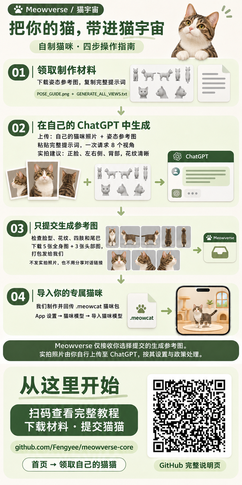

# 领取自己的猫猫 · 多视角参考图征集

简体中文 | [English](README.en.md) · [返回项目首页](../../README.md)

想让你家猫也住进 Meowverse？先用我们准备的姿态模板和提示词，在你自己的 ChatGPT 中制作一套多视角参考图，再把满意的**生成图**交给我们。你提供参考，我们尝试制作能导入 App 的猫咪包。

**这是人工征集与制作，提交后会先检查资料，暂不承诺完成时间或每份投稿都能制作成功。** 无需提交你的实拍照片、ChatGPT 对话记录或账号信息，也不要求打赏。

**[提交我的猫猫 →](https://github.com/Fengyee/meowverse-core/issues/new?template=03-cat-reference.yml)** · **[查看征集帖／在评论里上传 →](https://github.com/Fengyee/meowverse-core/issues/1)**

## 先领取材料

- **[姿态总览图（PNG）](POSE_GUIDE.png)**：八个机位的无花纹灰模排在一张图上，第 1 条消息用。
- **[八张单视角灰模（guides/）](guides/)**：`01_FRONT.png` … `08_HEAD_RIGHT.png`，第 2–9 条消息各用一张。
- **[十条提示词（prompts/）](prompts/)**：`00_SHEET.txt` … `09_PACKAGE.txt`，按文件名顺序复制，不用修改。
- **[精简用户包（ZIP）](Meowverse-Cat-Reference-Kit.zip)**：以上全部，加中英说明、署名和 Bella 操作海报；不包含私人照片、App 正式模型或设计源文件。

灰模只规定姿态、相机和取景，不规定猫的长相。下面这张海报画的是旧版「一条消息要八张图」的做法，步骤以本页为准；**请上传灰模，不要把海报当作姿态模板。** 二维码指向本说明页，二维码旁也写有仓库地址与「首页 → 领取自己的猫猫」路径。

## 1. 准备照片

选几张自家猫的清晰实拍：尽量覆盖正脸、左右侧和背部，能看清毛色边界、四肢和尾巴。只选你有权使用的照片，避开人脸、住址、证件等内容。

**实拍照片由你自行上传至 ChatGPT，不交给 Meowverse 制作方。** 它们会发送到你选择的第三方服务，按该账号的设置与服务政策处理；这不是本机生成流程。是否使用该服务由你决定。

## 2. 在一个新对话里发十条消息

每条消息**只附一张灰模**，发出后等它画完、写完一行自检，再发下一条。把多张灰模放进同一条消息，结果常常又是一张拼图。

| 条 | 附图 | 粘贴的文字 | 得到 |
|---|---|---|---|
| 1 | `POSE_GUIDE.png` 和你的全部猫咪照片 | `00_SHEET.txt` | 一张八格总览，先把猫定下来 |
| 2 | `guides/01_FRONT.png` | `01_FRONT.txt` | 全身正面 |
| 3 | `guides/02_LEFT.png` | `02_LEFT.txt` | 全身侧面，猫朝画面左侧 |
| 4 | `guides/03_RIGHT.png` | `03_RIGHT.txt` | 全身侧面，猫朝画面右侧 |
| 5 | `guides/04_BACK.png` | `04_BACK.txt` | 全身背面 |
| 6 | `guides/05_TOP.png` | `05_TOP.txt` | 全身俯视，猫头朝画面上方 |
| 7 | `guides/06_HEAD_FRONT.png` | `06_HEAD_FRONT.txt` | 头部正面 |
| 8 | `guides/07_HEAD_LEFT.png` | `07_HEAD_LEFT.txt` | 头部侧面，猫朝画面左侧 |
| 9 | `guides/08_HEAD_RIGHT.png` | `08_HEAD_RIGHT.txt` | 头部侧面，猫朝画面右侧 |
| 10 | 不附图 | `09_PACKAGE.txt` | `cat_views.zip`：总览、八张单图和一份说明 |

- 第 1 条最好把最能看出花纹的照片都放进去。总览图不像你的猫，就在这一步重来，后面八张都照它画。
- 每张图后面它会写一行自检，读一下。哪张不对（方向反了、腿或尾巴位置不对、猫太大、标志性的花纹丢了），就把**那一条连同它的灰模**再发一遍，前面加一句说清楚哪里不对。打包时它会取每个视角最后一张。
- 头部特写最容易丢掉标志性花纹，头也容易画大。重发时可以在提示词前写明丢了什么，比如「鼻头上那块黑斑没了」。侧脸可以对照灰模的位置：耳尖离上边约 10%，鼻尖离侧边约 11%，眼睛在约 45% 高处，嘴线在约 63% 高处。
- 偶尔它会一次出两张让你选，选和灰模大小、位置一致的那张。
- 第 10 条之后点下载链接拿到 ZIP，先读里面的说明：它会写出自己没做到的地方。

## 3. 检查后，只提交生成参考图

把每张单图和同名灰模并排看：机位、鼻子朝向、四肢和尾巴、猫的大小和位置都应和灰模一致。再看是不是同一只猫：脸型、体型、眼睛颜色和花纹边界应一致，左右花纹不能简单镜像；全身图四脚着地站立，可见脚掌不被画面裁切，尾巴水平向后伸，不能用坐姿或抬尾代替。严格侧面允许远侧腿被近侧腿挡住。灰模可以帮助核对，不能代替你判断像不像自己的猫。

第 10 条给出的 ZIP 已经按 `01_FRONT.png` … `08_HEAD_RIGHT.png` 命名，可以直接提交；先打开确认里面只有生成图和那份说明，没有实拍原照。如果打包失败，也可以逐张下载原尺寸图片，按上表的名字整理后自己打包。不要截图 ChatGPT 页面。

打开 **[猫猫参考图投稿入口](https://github.com/Fengyee/meowverse-core/issues/new?template=03-cat-reference.yml)**，登录 GitHub，给猫咪起一个可公开的昵称，把生成图或 ZIP 拖入附件区，再点击创建 Issue。**建议一只猫一条 Issue**，补图、制作进度与交付安排都在同一条里跟进；是否公开成品猫包另行确认。不用填写真实姓名、邮箱、电话或账号凭据。

也可以直接在 **[集中征集帖](https://github.com/Fengyee/meowverse-core/issues/1)** 的评论区按格式附图或 ZIP，不必另外开帖；公开与使用边界相同。

附件规则：

- 直接上传 PNG／JPG／JPEG：**单张不超过 10 MB**。
- 多张图片建议打成 **20 MB 以内的 ZIP**；GitHub 的其他附件单文件上限为 **25 MB**。超过建议大小时可分成两包，或适度压缩生成图。
- 等待附件上传完成再提交；不要只粘贴本地文件路径。此处的 20 MB 是整理建议，不是额外的自动校验功能。

GitHub 的限制与上传方式见 [官方附件说明](https://docs.github.com/en/get-started/writing-on-github/working-with-advanced-formatting/attaching-files)。

## 4. 收到猫咪包后，在 App 导入

我们先检查生成参考图，适合制作时再尝试建模、动作适配和猫包检查。仅靠参考图不保证模型一定成功；需要补图时，会在你的 Issue 里说明。当前不是 App 内的一键自动生成服务。

制作完成后，按 Issue 中的交付说明领取 `.meowcat` 文件。在支持猫咪包导入的 App 构建中打开：

**房间 → 更多（…）→ 设置 → 猫咪模型 → 导入猫咪模型…**

选取收到的文件，导入检查通过后再切换使用。若已安装的测试版没有该入口，请在 Issue 中注明构建号，等待适配说明；不要把参考 PNG 或 ZIP 当作已完成的猫咪包导入。

## 公开提交前，请确认这些边界

**这个仓库、Issue、评论和附件都是公开的，其他人可以查看和下载。** 附件开始上传时就会发送到 GitHub，请在拖入前检查画面、文件名和元数据。删除 Issue 不等于能够撤回别人保存的副本；不愿公开的图片不要通过这里提交。

生成图仍可能保留原照片里的外观、文字或背景线索，不能视为匿名化保证。请只提交干净背景的猫咪参考图，不发实拍原照、聊天记录、分享对话链接、付款截图、证件、API key 或设备标识。

提交表示你有权公开这些生成图，并允许维护者为本次参考评估和猫包制作处理它们；**不自动授权把它们加入 App 内置猫库、公开素材包、训练数据或其他商业发行**。如希望让更多用户使用你的猫，请在备注表达意愿，后续再单独确认具体采用和交付范围。用户投稿的权利不被仓库的非商业代码许可自动覆盖。

说明材料、灰模模板与 Bella 展示图的不同许可范围见 [来源与使用说明](ATTRIBUTION.md) 和 [仓库许可范围](../../LICENSE-SCOPE.md)。
